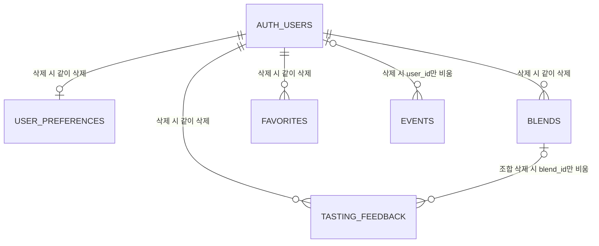

# scent-studio DB 설계안 (plan.md 단계 3) — 사장 검토용

> 2026-11-06 백엔드팀 작성. **사장 승인 전에는 마이그레이션·코드를 만들지 않는다.** 바탕: design.md 11·12·12-1·13절, 2026-10-30 사장 OK한 "저장할 데이터 목록". 바뀌는 점은 맨 아래 "design.md와 다른 점".

## 1. 큰 그림
- DB는 Supabase(PostgreSQL). 표 5개는 `app` 스키마에 둔다. `app`은 Supabase 공개 API에 노출하지 않는다.
- **앱은 DB에 직접 붙지 않는다.** 앱 → Spring 서버(단계 4) → DB. 서버는 로그인 토큰에서 꺼낸 사용자 id로만 행을 읽고 쓴다.
- 향수·노트 정보(카탈로그)는 DB에 넣지 않는다. 사용자 데이터는 카탈로그를 **key**로 가리킨다(6절).
- DB 계정 두 개: `postgres`(Supabase 기본, 표 만들기 전용) / `scent_server`(서버가 평소에 쓰는 계정, 5개 표 읽기·쓰기만, 표를 지우거나 바꾸는 권한 없음).

## 2. 표 5개

### ① `app.user_preferences` — 취향 설정 (한 사람당 한 줄)
| 칸 | 타입 | 필수 | 규칙 |
|---|---|---|---|
| user_id | uuid | ✓ | **기본 키**. 외래 키 → `auth.users(id)` 계정 삭제 시 같이 삭제 |
| preferred_families | text[] | ✓ (기본 빈 목록) | 최대 10개 (계열이 10개) |
| disliked_note_keys | text[] | ✓ (기본 빈 목록) | 최대 200개, 노트 key |
| updated_at | timestamptz | ✓ | 기본 지금 |

### ② `app.blends` — 저장한 조합
| 칸 | 타입 | 필수 | 규칙 |
|---|---|---|---|
| id | uuid | ✓ | **기본 키**, 자동 생성 |
| user_id | uuid | ✓ | 외래 키 → `auth.users(id)` 계정 삭제 시 같이 삭제. 인덱스 |
| name | text | ✓ | 1~40자, 앞뒤 공백만인 이름 불가 |
| families | text[] | ✓ (기본 빈 목록) | 최대 10개 |
| notes | jsonb | ✓ | `[{note_key, layer, strength}]` 1~9개. layer ∈ top/middle/base, **strength ∈ weak/medium/strong**, 층마다 3개까지, 같은 노트 한 번만 (DB 검사 함수로 막음) |
| created_at, updated_at | timestamptz | ✓ | 기본 지금 |
- (id, user_id) 묶음에 유일 키 → ④가 "내 조합"만 가리키게 하는 데 씀.

### ③ `app.favorites` — 찜
| 칸 | 타입 | 필수 | 규칙 |
|---|---|---|---|
| user_id | uuid | ✓ | 외래 키 → `auth.users(id)` 같이 삭제 |
| perfume_key | text | ✓ | 1~200자, 향수 key |
| created_at | timestamptz | ✓ | 기본 지금 |
- **기본 키 = (user_id, perfume_key)** → 같은 향수를 두 번 찜할 수 없다.

### ④ `app.tasting_feedback` — 시향 기록
| 칸 | 타입 | 필수 | 규칙 |
|---|---|---|---|
| id | uuid | ✓ | **기본 키**, 자동 생성 |
| user_id | uuid | ✓ | 외래 키 → `auth.users(id)` 같이 삭제. 인덱스 |
| perfume_key | text | ✓ | 1~200자 |
| blend_id | uuid | — | 외래 키 (blend_id, user_id) → ②(id, user_id). **남의 조합은 연결 불가**. 조합을 지우면 이 칸만 비움 |
| satisfaction | smallint | ✓ | 1~5 |
| similarity | smallint | ✓ | 1~5 |
| memo | text | — | 500자 이하 |
| tested_at | timestamptz | ✓ | 기본 지금 |
| rank | smallint | — | 1~10 (추천 몇 위에서 골랐나) |
| score | double precision | — | 0~1 |
| engine_version | integer | ✓ | 그때 엔진 (지금 8) |
| catalog_version | text | ✓ | 그때 카탈로그 (예: 2026.11.05) |
| created_at | timestamptz | ✓ | 기본 지금 |

### ⑤ `app.events` — 사용 기록
| 칸 | 타입 | 필수 | 규칙 |
|---|---|---|---|
| id | bigint | ✓ | **기본 키**, 자동 증가 |
| install_id | uuid | ✓ | 설치 때 만든 무작위 값 (광고 ID 아님). 인덱스 |
| user_id | uuid | — | 외래 키 → `auth.users(id)`, **계정 삭제 시 비움(익명으로 남김)** |
| name | text | ✓ | 정해진 8종만: app_open, blend_started, blend_summary_viewed, recs_viewed, perfume_opened, blend_saved, favorite_added, feedback_submitted |
| props | jsonb | ✓ (기본 `{}`) | 객체만, 2KB 이하 |
| app_version | text | ✓ | 1~32자 |
| occurred_at | timestamptz | ✓ | 기기에서 일어난 때 |
| received_at | timestamptz | ✓ | 기본 지금 (서버가 받은 때) |

### 관계 그림

`AUTH_USERS`는 Supabase 로그인이 관리하는 계정 표(우리가 만들지 않음).

## 3. 승인 목록 중 어느 항목을 맡나
| 표 | 승인 항목 | 설명 |
|---|---|---|
| user_preferences | **C1·C2·C3**(로그인 상태일 때 서버 쪽), **D6**(로그인 후 합치기) | C는 로그인 없이도 되어야 해서 먼저 기기에 저장하고, 로그인하면 이 표와 합친다 |
| blends | **D2**(이름 붙여 저장), **D5**(보관함에서 다시 열기) | |
| favorites | **D3**(찜 / 찜 풀기) | |
| tasting_feedback | **D4**(점수·메모가 시향 기록에) | |
| events | **I1·I2**(사용 기록, 끊겼다 다시 보내기) | |
| 5개 전부 | **G2**(삭제 뒤 보관함이 빔) | 4절 |
- G1(확인 창)·G3(링크)은 화면 일, D1(비로그인 → 로그인 화면)은 화면·서버 일이라 표가 맡지 않는다.
- 승인 목록은 가짜 서버로 돌리므로, 이 표들은 단계 3의 DB 테스트와 단계 4의 서버 테스트로 따로 확인한다.

## 4. 계정 삭제 때 데이터가 지워지는 방식
1. 사용자가 마이 → 계정 삭제 → 확인 (G1).
2. 서버(`DELETE /me`)가 토큰의 사용자 id로 **Supabase에 그 계정 삭제를 요청**한다(서비스 키는 서버 `.env`에만).
3. 계정 표(`auth.users`)에서 그 줄이 사라지면, **DB가 외래 키 규칙으로 자동 정리**한다: ①②③④의 그 사람 줄 전부 삭제, ⑤는 user_id만 비워 익명 통계로 남긴다. 한 번에 일어나서 "반만 지워진" 상태가 없다.
4. Supabase 요청이 실패하면 아무것도 지워지지 않고 오류를 돌려준다(다시 시도 가능).
- Supabase 대시보드에서 사장이 계정을 직접 지워도 같은 규칙으로 데이터가 같이 지워진다.
- 서버가 지운 뒤 "그 사람 줄이 0개"인지 한 번 더 확인하고 응답한다(단계 4).

## 5. 접근 막기 (RLS)
모든 표에 RLS(줄 단위 접근 규칙)를 켠다. 규칙이 없는 계정은 아무 줄도 못 본다.

| 표 | 앱의 공개 키(anon) | 로그인 사용자가 Supabase에 직접(authenticated) | 서버 계정 `scent_server` |
|---|---|---|---|
| user_preferences | 읽기 ✗ 쓰기 ✗ | 읽기 ✗ 쓰기 ✗ | 읽기·추가·수정·삭제 ✓ |
| blends | ✗ ✗ | ✗ ✗ | 읽기·추가·수정·삭제 ✓ |
| favorites | ✗ ✗ | ✗ ✗ | 읽기·추가·삭제 ✓ (수정 없음) |
| tasting_feedback | ✗ ✗ | ✗ ✗ | 읽기·추가 ✓ (1차는 수정·삭제 기능 없음, 계정 삭제는 4절 규칙으로) |
| events | ✗ ✗ | ✗ ✗ | **추가만** ✓ (읽기는 통계 볼 때 사장이 대시보드에서) |

- 막는 장치 세 겹: ① `app` 스키마를 공개 API에 노출 안 함 ② anon·authenticated에게 `app` 사용 권한 자체를 주지 않음 ③ RLS를 켜고 `scent_server`에만 규칙을 둠.
- "이 줄이 요청한 사람 것인가"는 서버가 토큰의 사용자 id로 확인한다(단계 4 서버 테스트: 남의 조합 못 읽고 못 지움).
- `scent_server`는 표를 만들거나 지울 수 없다. 표 만들기는 `postgres` 계정으로 마이그레이션 때만.

## 6. 향수를 이름이 아니라 key로 가리키나 — 예
- **향수 key** = Parfumo 상품 주소의 `/Perfumes/` 뒤 부분 (예: `Le_Re_Noir:455-tabac-ecarlate`, `pipeline/catalog_rules.py` `perfume_key`). 이름·브랜드 표기를 고쳐도 바뀌지 않는다. 표시용 이름은 저장하지 않고 화면이 카탈로그에서 찾는다.
- **노트 key** = 정리된 영문 이름 (예: `sandalwood`). 한글명을 고쳐도 그대로다.
- **강도는 숫자가 아니라 이름(weak/medium/strong)으로** 저장한다. 엔진 숫자는 1.5 → 2.0 → 3.0으로 바뀐 적이 있어서, 숫자로 저장하면 엔진이 바뀔 때 옛 조합이 깨진다.
- 카탈로그가 DB에 없으니 DB 외래 키로 "있는 향수인가"를 막을 수는 없다. 서버가 저장할 때 지금 카탈로그에 있는 key인지 확인하고(단계 4), 나중 카탈로그에서 빠진 향수는 보관함에 "목록에서 빠진 향수"로 남겨 보여 준다(지우지 않음).

## 7. 카탈로그 크기 방향 — DB가 아니라 파일 배포 유지
- **방향: 지금처럼 파일 하나(`catalog.json.gz`)로 앱에 넣고, 새 버전은 서버가 파일로 내려 준다. DB에는 넣지 않는다.**
- 이유: ① 추천을 기기에서 계산하려면(D1, 오프라인) 카탈로그 전체가 어차피 기기에 있어야 한다 ② DB에 넣으면 앱이 열릴 때마다 큰 데이터를 받아 무료 요금제 전송량을 빨리 쓴다 ③ 카탈로그는 읽기 전용이고 버전 단위로 통째로 바뀌어서 파일이 맞다.
- 지금 크기: 압축 2.29MB (풀면 10.7MB). 설계 기준 "5MB가 넘으면 바이너리 형식"에는 안 걸린다.
- 줄이는 방향(실제 작업은 단계 4): 앱이 안 쓰는 칸 빼기 → 숫자 자릿수 줄이기 순. **엔진 동결 때문에 조건이 있다:** 줄인 파일로 474개 쿼리의 Top 10 순위·등급이 하나도 안 바뀌어야 쓴다. 바뀌면 그 줄이기는 하지 않는다.

## 8. 테스트 DB (내 컴퓨터, 사장 할 일 없음)
- `backend/`에 Gradle 프로젝트 뼈대 + Flyway 마이그레이션 `V1__init.sql` + JUnit 테스트. 내장 Postgres(zonky, Docker 필요 없음)로 돈다. 이 컴퓨터에 Java 21이 이미 있다.
- 테스트 DB에는 Supabase의 `auth.users`가 없으므로 테스트 준비 코드가 빈 `auth.users` 표를 먼저 만든다.
- 확인할 것: 마이그레이션이 처음부터 끝까지 돈다 / 잘못된 값(만족도 6, 이름 41자, 층에 노트 4개, 같은 노트 두 번, 모르는 강도, 모르는 기록 이름, 찜 중복, 남의 조합을 시향 기록에 연결)이 막힌다 / 계정 줄을 지우면 ①~④가 사라지고 ⑤는 user_id만 빈다 / anon·authenticated 역할로는 5개 표를 못 읽는다 / `scent_server`는 읽고 쓸 수 있지만 표를 지울 수 없다.
- `tests/run.sh`에 `backend` 테스트를 더한다.

## 9. 실제 Supabase에서 사장님이 하실 일 (테스트 DB 통과 뒤, 순서대로)
비밀번호·키는 **대화창에 붙여 넣지 마시고** 아래 적은 곳에만 넣어 주세요.
1. https://supabase.com 가입(GitHub 계정으로 로그인) → **New project**
   - Name `perfumer-lab`, Region **Northeast Asia (Seoul)**, 요금제 Free
   - Database Password: **Generate a password** → 비밀번호 관리자에 저장
2. 프로젝트가 만들어지면 **Project Settings → Data API**에서 Exposed schemas가 `public`(과 `graphql_public`)뿐인지 확인. **`app`을 추가하지 않는다.**
3. **Connect** 버튼 → **Session pooler** 연결 정보를 직원이 만들어 둔 `apps/scent-studio/backend/.env`(`.env.example`을 복사한 것)의 `DB_URL`·`DB_MIGRATION_PASSWORD` 칸에 붙여 넣기
4. 직원에게 "넣었다"고 말하기 → 직원이 마이그레이션을 실행해 표 5개와 `scent_server` 계정(로그인 불가 상태)을 만든다
5. **SQL Editor**에서 직원이 드리는 한 줄을 비밀번호만 바꿔 실행: `alter role scent_server with login password '<새 비밀번호>';` → 같은 비밀번호를 `.env`의 `DB_SERVER_PASSWORD`에
6. 직원이 확인: Table Editor에 `app` 표 5개 / 공개 키로 `app` 표 읽기 시도가 막힘 (plan.md 단계 3 끝 기준)
7. (일시 정지 방지) GitHub 저장소 **Settings → Secrets and variables → Actions**에 직원이 알려 드리는 이름 2개를 등록 → 하루 한 번 깨우는 예약 작업이 돈다. 서버가 생기면(단계 4) 서버 상태 확인 주소로 바꾼다.
8. (구글 로그인 — 단계 5 로그인 화면 전까지만 하면 됨) Google Cloud Console에서 OAuth 동의 화면 + 웹 클라이언트 ID 만들기, 승인된 리디렉션 주소에 `https://<프로젝트 주소>.supabase.co/auth/v1/callback` → Supabase **Authentication → Sign In / Providers → Google**에 Client ID·Secret 넣기. 이때 화면별 안내를 따로 드린다.
- 무료 요금제 한계(7일 쉬면 일시 정지, 백업 범위)는 NOTES에 적는다. 백업 범위는 연결 뒤 대시보드에서 확인해 적는다.

## 10. design.md와 다른 점 (승인되면 design.md 12절을 고친다)
| 무엇 | design.md 12절 | 이 안 | 이유 |
|---|---|---|---|
| 향수 key 설명 | "Parfumo 번호" | 상품 주소 뒷부분 | 번호가 겹쳐서 이미 주소로 바꿨다(plan.md "이전 계획에서 정한 것"). 문서만 낡음 |
| 강도 저장 | intensity(숫자) | strength(weak/medium/strong) | 엔진 숫자가 바뀌어도 옛 조합 유지 |
| 계정 삭제 | 서버가 한 트랜잭션에서 지움 | Supabase 계정 삭제 → DB 외래 키가 자동 정리 | 순서가 하나라 반만 지워진 상태가 없고, 대시보드 삭제에도 적용 |
| 시향 기록의 조합 연결 | blend_id(선택) | (blend_id, user_id) 묶음 외래 키 | 남의 조합을 연결하는 걸 DB에서도 막음 |
| RLS | 켜고 정책 없음 | 켜고 `scent_server`에만 정책 | 정책이 전혀 없으면 서버 계정도 못 읽는다(서버 계정은 표 주인이 아니라서). 공개 키 쪽은 똑같이 다 막힘 |
| DB 계정 | 서버 전용 계정 하나 | 표 만들기용(`postgres`) + 평소용(`scent_server`) | 평소 계정이 뚫려도 표를 지우거나 바꿀 수 없게 |
