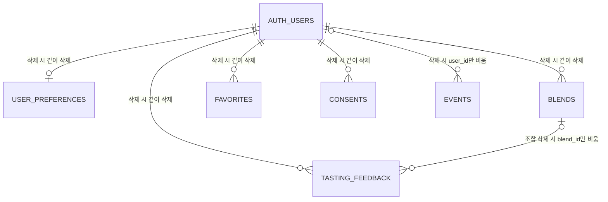

# scent-studio DB 설계안 (plan.md 단계 3) — 사장 검토용

> 2026-11-06 백엔드팀 작성. 2026-11-06 사장 1차 검토: 방향 OK, 보완 11개 요청 → 2판. 2026-11-06 사장 2차 검토: 초대제 제거(공개 배포 기준)·비밀번호 32자 등 → **3판(이 문서), 2026-11-06 사장 승인** → 테스트 DB 작업 시작. 바탕: design.md 11·12·12-1·13절, 2026-10-30 사장 OK한 "저장할 데이터 목록". design.md와 바뀌는 점은 맨 아래 "design.md와 다른 점".
> "(연결 뒤 확인)"이 붙은 것은 Supabase 문서 기준 추정이고, 실제 프로젝트에 붙인 뒤 직접 확인해 NOTES에 적는다.

## 1. 큰 그림
- DB는 Supabase(PostgreSQL). 표는 `app` 스키마에 둔다. `app`은 Supabase 공개 API에 노출하지 않는다.
- **앱은 DB에 직접 붙지 않는다.** 앱 → Spring 서버(단계 4) → DB. 서버는 로그인 토큰에서 꺼낸 사용자 id로만 행을 읽고 쓴다.
- 향수·노트 정보(카탈로그)는 DB에 넣지 않는다. 사용자 데이터는 카탈로그를 **key**로 가리킨다(6절).
- DB 계정 두 개: `postgres`(Supabase 기본, 표 만들기 전용) / `scent_server`(서버가 평소에 쓰는 계정, 표 읽기·쓰기만, 표를 지우거나 바꾸는 권한 없음).
- 표는 **6개**: 사용자 데이터 5개(①~⑤) + 동의 ⑥. (2판의 초대 표는 3판에서 뺐다, 9절)

## 2. 표

### ① `app.user_preferences` — 취향 설정 (한 사람당 한 줄)
| 칸 | 타입 | 필수 | 규칙 |
|---|---|---|---|
| user_id | uuid | ✓ | **기본 키**. 외래 키 → `auth.users(id)` 계정 삭제 시 같이 삭제 |
| preferred_families | text[] | ✓ (기본 빈 목록) | 최대 10개 (계열이 10개) |
| disliked_note_keys | text[] | ✓ (기본 빈 목록) | 최대 200개, 노트 key |
| updated_at | timestamptz | ✓ | 기본 지금, **수정하면 트리거가 자동으로 지금으로 바꿈** |

### ② `app.blends` — 저장한 조합
| 칸 | 타입 | 필수 | 규칙 |
|---|---|---|---|
| id | uuid | ✓ | **기본 키**, 자동 생성 |
| user_id | uuid | ✓ | 외래 키 → `auth.users(id)` 계정 삭제 시 같이 삭제. 인덱스 |
| name | text | ✓ | 1~40자, 앞뒤 공백만인 이름 불가 |
| families | text[] | ✓ (기본 빈 목록) | 최대 10개 |
| notes | jsonb | ✓ | `[{note_key, layer, strength}]` 1~9개. layer ∈ top/middle/base, **strength ∈ weak/medium/strong**, 층마다 3개까지, 같은 노트 한 번만 (DB 검사 함수로 막음) |
| created_at | timestamptz | ✓ | 기본 지금 |
| updated_at | timestamptz | ✓ | 기본 지금, **수정하면 트리거가 자동 갱신** |
- (id, user_id) 묶음에 유일 키 → ④가 "내 조합"만 가리키게 하는 데 씀.

### ③ `app.favorites` — 찜
| 칸 | 타입 | 필수 | 규칙 |
|---|---|---|---|
| user_id | uuid | ✓ | 외래 키 → `auth.users(id)` 같이 삭제 |
| perfume_key | text | ✓ | 1~200자, 향수 key |
| created_at | timestamptz | ✓ | 기본 지금 |
- **기본 키 = (user_id, perfume_key)** → 같은 향수를 두 번 찜할 수 없다.

### ④ `app.tasting_feedback` — 시향 기록
| 칸 | 타입 | 필수 | 규칙 |
|---|---|---|---|
| id | uuid | ✓ | **기본 키**, 자동 생성 |
| user_id | uuid | ✓ | 외래 키 → `auth.users(id)` 같이 삭제. 인덱스 |
| perfume_key | text | ✓ | 1~200자 |
| blend_id | uuid | — | 외래 키 (blend_id, user_id) → ②(id, user_id). **남의 조합은 연결 불가**. 조합을 지우면 이 칸만 비움 |
| satisfaction | smallint | ✓ | 1~5 |
| similarity | smallint | ✓ | 1~5 |
| memo | text | — | 500자 이하 |
| tested_at | timestamptz | ✓ | 기본 지금 |
| rank | smallint | — | 1~10 (추천 몇 위에서 골랐나) |
| score | double precision | — | 0~1 |
| engine_version | integer | ✓ | 그때 엔진 (지금 8) |
| catalog_version | text | ✓ | 그때 카탈로그 (예: 2026.11.05) |
| created_at | timestamptz | ✓ | 기본 지금 |
- **1차에 본인 기록 삭제를 넣는다**(사장 결정 2026-11-06). 수정은 나중 차수. 서버 `DELETE /feedback/{id}`(단계 4)는 내 기록일 때만 지운다.

### ⑤ `app.events` — 사용 기록
| 칸 | 타입 | 필수 | 규칙 |
|---|---|---|---|
| id | bigint | ✓ | **기본 키**, 자동 증가 |
| install_id | uuid | ✓ | 설치 때 만든 무작위 값 (광고 ID 아님). 인덱스 |
| user_id | uuid | — | 외래 키 → `auth.users(id)`, **계정 삭제 시 비움(익명으로 남김)** |
| name | text | ✓ | 정해진 8종만: app_open, blend_started, blend_summary_viewed, recs_viewed, perfume_opened, blend_saved, favorite_added, feedback_submitted |
| props | jsonb | ✓ (기본 `{}`) | 객체만, 2KB 이하 |
| app_version | text | ✓ | 1~32자 |
| occurred_at | timestamptz | ✓ | 기기에서 일어난 때 |
| received_at | timestamptz | ✓ | 기본 지금 (서버가 받은 때). 인덱스 (보관 기간 삭제에 씀) |
- 보관 기간과 계정 삭제 뒤 처리는 4-2절.

### ⑥ `app.consents` — 약관·방침 동의 기록 (새로)
| 칸 | 타입 | 필수 | 규칙 |
|---|---|---|---|
| id | bigint | ✓ | **기본 키**, 자동 증가 |
| user_id | uuid | ✓ | 외래 키 → `auth.users(id)` **계정 삭제 시 같이 삭제** |
| doc_type | text | ✓ | `terms`(이용약관) / `privacy`(개인정보 처리 방침) / `age_14`(만 14세 이상 확인) 셋 중 하나 |
| doc_version | text | ✓ | 문서 버전, 예 `2026-11-06`. `age_14`도 그때 문구 버전을 적음 |
| agreed_at | timestamptz | ✓ | 기본 지금 (서버 시각, 앱이 보낸 시각은 안 믿음) |
| app_version | text | ✓ | 동의한 앱 버전, 1~32자 |
- 같은 (user_id, doc_type, doc_version)은 한 번만(유일 키). **새 버전에 다시 동의하면 줄이 하나 더 생긴다(지우지 않고 쌓음)** → "언제 어느 버전에 동의했나"가 남는다.
- 서버(단계 4)는 지금 버전의 `terms`·`privacy`·`age_14` 세 줄이 다 있어야 저장·찜·피드백을 받는다. 없으면 `CONSENT_REQUIRED` 오류 → 앱이 동의 화면을 띄운다. 만 14세 미만이라고 답하면 가입을 끝내지 않는다(법정대리인 동의 절차를 만들지 않으므로).
- **user_preferences에 칸을 두지 않은 이유:** 문서가 셋이고 버전이 바뀔 때마다 기록이 쌓여야 하는데, 한 사람 한 줄인 표에 두면 옛 동의 기록을 덮어쓴다. 또 취향은 로그인 전 기기 값과 합쳐지는 데이터라 성격이 다르다.
- 법률 검토는 아니다. 약관·방침 문구와 "삭제 후에도 동의 기록을 남겨야 하는가"는 공개 배포 전에 사장이 확인한다(지금은 삭제가 기본).

### 관계 그림

`AUTH_USERS`는 Supabase 로그인이 관리하는 계정 표(우리가 만들지 않음).

### updated_at 자동 갱신 (확인 7)
- 1판에는 **트리거가 없었다**(기본값만 있어 처음 만들 때만 채워지고, 고칠 때는 안 바뀜). 2판에서 `app.touch_updated_at()` 트리거를 ①·②에 붙인다(수정 직전에 updated_at = 지금). 서버가 값을 안 넣어도, 잘못 넣어도 DB가 덮어쓴다. 8절 테스트에 넣는다.

## 3. 승인 목록 중 어느 항목을 맡나
| 표 | 승인 항목 | 설명 |
|---|---|---|
| user_preferences | **C1·C2·C3**(로그인 상태일 때 서버 쪽), **D6**(로그인 후 합치기, 5절) | C는 로그인 없이도 되어야 해서 먼저 기기에 저장하고, 로그인하면 이 표와 합친다 |
| blends | **D2**, **D5** | |
| favorites | **D3** | |
| tasting_feedback | **D4** | 본인 기록 삭제는 승인 목록 밖(서버 테스트로 확인) |
| events | **I1·I2** | |
| 6개 전부 | **G2**(삭제 뒤 보관함이 빔) | 4절 |
| consents | 승인 목록에 없음 | 실제 가입 흐름이라 단계 3 DB 테스트·단계 4 서버 테스트·6단계 사장 직접 확인으로 본다. 승인 테스트는 가짜 서버가 "동의 끝난 사용자"로 응답한다 |
- G1(확인 창)·G3(링크)은 화면 일, D1(비로그인 → 로그인 화면)은 화면·서버 일이라 표가 맡지 않는다.

## 4. 삭제 규칙

### 4-1. 계정 삭제
1. 사용자가 마이 → 계정 삭제 → 확인 (G1).
2. 서버(`DELETE /me`)가 토큰의 사용자 id로 **Supabase에 그 계정 삭제를 요청**한다(서비스 키는 서버 `.env`에만).
3. 계정 줄이 사라지면 **DB가 외래 키 규칙으로 한 번에 정리**한다:
   | 표 | 계정 삭제 시 |
   |---|---|
   | ① 취향 · ② 조합 · ③ 찜 · ④ 시향 기록 · ⑥ 동의 | 그 사람 줄 전부 삭제 |
   | ⑤ 사용 기록 | user_id만 비움 (4-2절) |
4. Supabase 요청이 실패하면 아무것도 지워지지 않고 오류를 돌려준다(다시 시도 가능). 대시보드에서 사장이 계정을 지워도 같은 규칙이 적용된다.
5. 서버가 지운 뒤 "그 사람 줄이 0개"인지 한 번 더 확인하고 응답한다(단계 4).

### 4-2. 사용 기록 보관 기간과 계정 삭제 뒤 install_id (정할 것 3)
- **보관 기간 제안: 12개월.** 성공 기준(완성률·저장률·7일 재방문율)은 길어야 몇 달 치면 계산된다. 기준은 `received_at`(서버 시각, 기기 시계를 믿지 않음).
- **지우는 방법:** `app.purge_old_events()` 함수(12개월 지난 줄 삭제, 지운 수 반환)를 마이그레이션에 넣고 테스트한다. 매일 돌리는 일은 Supabase의 **pg_cron**(DB 안 예약 작업)에 사장이 SQL 한 줄로 등록한다(9절). 테스트 DB에는 pg_cron이 없어서 등록 줄은 마이그레이션에 넣지 않는다. GitHub 예약 작업으로 지우려면 DB 비밀번호를 GitHub에 맡겨야 해서 쓰지 않는다.
- **계정 삭제 뒤 install_id:** user_id를 비워도 install_id가 남아, 같은 기기의 삭제 전 기록과 삭제 후 기록이 이어진다.
  | 방법 | 좋은 점 | 나쁜 점 |
  |---|---|---|
  | (가) 그대로 두고 방침에 적기 | 가장 간단, 통계 손실 없음 | 삭제 후에도 같은 기기라는 연결이 남음 → "계정 삭제"의 기대와 어긋남 |
  | (나) 그 사람이 쓴 install_id의 기록을 전부 같이 지우기 | 흔적이 가장 적음 | 같은 기기를 다른 사람과 썼으면 그 사람 기록까지 지움. 로그인 전 기록은 누구 것인지 몰라 경계가 애매. 통계가 구멍 남 |
  | **(다) 추천: 끊기** — DB는 user_id만 비우고, 앱은 계정 삭제가 끝나면 **install_id를 새로 만든다** | 삭제 전·후 기록이 이어지지 않음. 옛 기록은 누구 것인지 모르는 익명 통계로 12개월 뒤 사라짐. 다른 사람 기록을 건드리지 않음 | 앱이 install_id를 바꿔야 함(단계 5·6 할 일, 앱 부품 테스트로 확인). 웹 브라우저 저장소를 지우지 않고 앱을 지운 경우 같은 예외는 남음 |
  - 방침 문구에는 "계정을 삭제하면 사용 기록은 누구 것인지 알 수 없는 상태로 바뀌고, 12개월 뒤 지워진다"를 적는다.

### 4-3. 시향 기록 본인 삭제 (정할 것 6)
- `DELETE /feedback/{id}`: 서버가 `id`와 토큰의 사용자 id가 둘 다 맞는 줄만 지운다. 남의 기록 id를 넣으면 "없음"(404)으로 답한다(있는지 여부도 알려 주지 않음). 단계 4 서버 테스트에 넣는다.

## 5. D6 로그인 후 합치기 규칙 (정할 것 5)
로그인 전에는 취향을 기기에만 저장하고, 로그인하면 서버 값과 한 번 합친다.
| 항목 | 규칙 | 이유 |
|---|---|---|
| 불호 노트 | **합집합** (기기 ∪ 서버) | 싫다고 한 노트가 추천에 다시 나오는 쪽이 더 나쁘다. 승인 D6이 이 규칙(패출리 + 오크모스 둘 다) |
| 선호 계열 | **서버에 하나라도 있으면 서버 값**, 서버가 비어 있으면 기기 값 | 선호는 순위만 바꾸는 약한 설정이라 섞으면 의도가 흐려진다. 예전에 정한 규칙(spec.md 기능 6) 그대로 |
| 200개 초과 | 서버 것을 먼저 다 넣고 기기 것을 200개까지만 더함. 잘린 게 있으면 앱이 "불호 노트가 200개를 넘어 일부는 저장되지 않았어요" 안내 | DB 상한 200 |
| 합친 뒤 | 합친 값을 서버에 저장하고 기기 값도 같은 값으로 바꾼다. 이후에는 로그인 중 바꾸면 서버에 바로 저장 | 두 곳이 계속 달라지는 걸 막음 |
| 알려진 한계 | 로그인 전에 기기에서 불호를 **지웠는데** 서버에는 남아 있으면, 합집합이라 다시 살아난다 | 1차에는 감수. 마이에서 다시 지우면 된다 |
- 조합·찜·시향 기록은 로그인해야 저장되므로(D1) 합칠 것이 없다.
- 합치기는 앱이 계산해 `PUT /me/preferences`로 보내는 방식이 아니라 **서버가 합친다**(`POST /me/preferences/merge`, 단계 4). 여러 기기에서 동시에 로그인해도 서버가 한 번에 처리한다.

## 6. 향수를 이름이 아니라 key로 가리키나 — 예
- **향수 key** = Parfumo 상품 주소의 `/Perfumes/` 뒤 부분 (예: `Le_Re_Noir:455-tabac-ecarlate`, `pipeline/catalog_rules.py` `perfume_key`). 이름·브랜드 표기를 고쳐도 바뀌지 않는다. 표시용 이름은 저장하지 않는다.
- **노트 key** = 정리된 영문 이름 (예: `sandalwood`).
- **강도는 이름(weak/medium/strong)으로** 저장한다. 엔진 숫자는 1.5 → 2.0 → 3.0으로 바뀐 적이 있다.
- 카탈로그가 DB에 없으니 서버가 저장할 때 지금 카탈로그에 있는 key인지 확인하고(단계 4), 나중 카탈로그에서 빠진 향수는 보관함에 "목록에서 빠진 향수"로 남겨 보여 준다.

## 7. 카탈로그 크기 방향 — DB가 아니라 파일 배포 유지
- **방향: 파일 하나(`catalog.json.gz`)를 앱에 넣고, 새 버전은 서버가 파일로 내려 준다. DB에는 넣지 않는다.**
- 이유: ① 기기 안 추천(D1, 오프라인)에는 카탈로그 전체가 기기에 있어야 한다 ② DB에 넣으면 무료 요금제 전송량을 빨리 쓴다 ③ 읽기 전용이고 버전 단위로 통째로 바뀐다.
- 지금 압축 2.29MB (풀면 10.7MB). 줄이는 작업은 단계 4: 앱이 안 쓰는 칸 빼기 → 숫자 자릿수 줄이기 순. **엔진 동결 조건:** 줄인 파일로 474개 쿼리의 Top 10 순위·등급이 하나도 안 바뀌어야 쓴다.

## 8. 1인당 한도 (정할 것 4, 서버에서 확인, 단계 4)
| 항목 | 제안 한도 | 근거 |
|---|---|---|
| 저장한 조합 | **100개** | 내부 테스트 사용자가 실제로 쓸 양보다 넉넉하고, 보관함 목록 한 화면 스크롤로 감당되는 수 |
| 찜 | **300개** | 향수 둘러보기는 조합보다 많이 누름. 카탈로그 1.2만 개의 약 2.5% |
| (참고) 시향 기록 | 1,000개 | 요청은 없었지만 같은 방식으로 막아 두면 무한 쌓기 공격을 막는다 |
| (이미 있음) 불호 노트 200 · 선호 계열 10 · 사용 기록 분당 요청 제한 | | DB 검사·서버 |
- 넘으면 `LIMIT_REACHED` 오류 → 앱이 "조합은 100개까지 저장할 수 있어요" 안내.
- **동시 요청으로 한도를 넘지 않게:** 서버가 그 사용자 단위 잠금을 건 트랜잭션 안에서 개수를 세고 넣는다(보안 규칙 "한 번만 돼야 하는 처리"와 같은 방식). 단계 4 서버 테스트에 "동시에 20번 저장해도 100개를 넘지 않음"을 넣는다.

## 9. 초대제 — 검토했으나 공개 배포로 결정 (2026-11-06)
- 사장 결정(2026-11-06): **Fragrantica가 비상업 무료 앱으로 허가해 준다는 전제로, 초대제 없이 공개 배포 기준으로 진행한다.** 초대 표·가입 직전 검사 함수·관련 테스트는 만들지 않는다.
- 2판에서 비교한 세 방법: (a) 초대 표 + 서버 확인(초대 안 된 사람 계정이 Supabase에 먼저 생김) / (b) Supabase 가입 막기 + 대시보드 초대(구글 로그인과 이어지는 순서가 까다롭고 메일 한도) / **(c) 초대 표 + Supabase Before User Created 훅으로 가입 직전 거절(추천했던 안)**.
- **나중에 다시 초대제가 필요하면 (c)안을 쓴다.** 자세한 내용은 git 기록의 2판(커밋 8999d9a) 9절.
- 허가가 거절될 때의 위험과 출시 직전 확인은 `plan.md` "출시 직전 확인 항목"·`design.md` 17절.

## 10. 접근 막기 (RLS)
모든 표에 RLS(줄 단위 접근 규칙)를 켠다. 규칙이 없는 계정은 아무 줄도 못 본다.

| 표 | 앱의 공개 키(anon) | 로그인 사용자가 Supabase에 직접(authenticated) | 서버 계정 `scent_server` |
|---|---|---|---|
| user_preferences | ✗ | ✗ | 읽기·추가·수정·삭제 |
| blends | ✗ | ✗ | 읽기·추가·수정·삭제 |
| favorites | ✗ | ✗ | 읽기·추가·삭제 |
| tasting_feedback | ✗ | ✗ | 읽기·추가·**삭제**(2판에서 추가) |
| events | ✗ | ✗ | **추가만** |
| consents | ✗ | ✗ | **읽기·추가만** (고치거나 지울 수 없음, 지우기는 계정 삭제 규칙으로만) |

- 막는 장치 세 겹: ① `app` 스키마를 공개 API에 노출 안 함 ② anon·authenticated에게 `app` 사용 권한 자체를 주지 않음 ③ RLS를 켜고 `scent_server`에만 규칙을 둠.
- 예외 하나: 일시 정지 방지용 `public.keepalive()` 함수(11절 확인 9). `select 1`만 돌려주고 표를 읽지 않는다.
- "이 줄이 요청한 사람 것인가"는 서버가 토큰의 사용자 id로 확인한다(단계 4).

## 11. 확인 결과
| # | 확인할 것 | 결과 |
|---|---|---|
| 7 | updated_at 자동 갱신 | 1판엔 없었음 → 트리거 추가(2절 끝) |
| 8 | `scent_server`가 Session pooler로 접속될 때 | Session pooler(Supavisor)는 사용자 이름을 **`역할.프로젝트참조값`** 형식으로 받는다. 예: `scent_server.abcdefghijklmnop`, 호스트 `aws-0-ap-northeast-2.pooler.supabase.com`, 포트 **5432**(세션 방식). 직접 만든 역할도 로그인·비밀번호가 있으면 이 형식으로 접속된다(연결 뒤 확인). 주의: ① 포트 6543(트랜잭션 방식)은 서버의 미리 준비한 쿼리와 충돌할 수 있어 쓰지 않는다 ② 무료 요금제의 직접 접속 주소는 IPv6 전용이라 이 컴퓨터·Render에서 안 될 수 있어 pooler를 쓴다 ③ 마이그레이션도 같은 pooler로 `postgres.프로젝트참조값` 이름을 쓴다 ④ 비밀번호에 `@ : / ?`가 있으면 접속 주소가 깨지므로 영문·숫자만으로 32자 이상 만든다 |
| 9 | 일시 정지 방지 예약 작업이 서비스 키를 쓰나 | **쓰지 않는다.** GitHub Actions는 **공개 키(publishable/anon)** 와 프로젝트 주소 2개만 GitHub Secrets에 두고 `public.keepalive()`를 부른다. 공개 키는 원래 앱에 들어가는 키라 새어도 RLS로 막혀 있다. 서비스 키·DB 비밀번호는 GitHub에 두지 않는다. 단계 4에서 서버가 생기면 서버 상태 확인 주소로 바꾼다(서버 → DB까지 닿음). 공개 키로 함수를 부르는 것이 "활동"으로 세어지는지는 연결 뒤 7일 지켜보며 확인 |
| 10 | text[]·jsonb를 별도 표로 안 나눈 이유 | design.md 12절에 한 줄 추가함 |

## 12. 테스트 DB (내 컴퓨터, 사장 할 일 없음)
- `backend/`에 Gradle 프로젝트 뼈대 + Flyway 마이그레이션 `V1__init.sql` + JUnit 테스트. 내장 Postgres(zonky, Docker 필요 없음). Java 21은 이미 있다.
- 테스트 준비 코드가 Supabase에만 있는 것을 흉내 낸다: 빈 `auth.users` 표, `anon`·`authenticated` 역할.
- 확인할 것:
  - 마이그레이션이 처음부터 끝까지 돈다
  - 잘못된 값이 막힌다: 만족도 6, 이름 41자, 층에 노트 4개, 같은 노트 두 번, 모르는 강도, 모르는 기록 이름, 찜 중복, 남의 조합을 시향 기록에 연결, 모르는 동의 문서 종류, 같은 버전 동의 두 번
  - 계정 줄을 지우면 ①②③④⑥이 사라지고 ⑤는 user_id만 빈다
  - updated_at이 수정 때 바뀐다
  - `app.purge_old_events()`가 12개월 지난 줄만 지운다
  - anon·authenticated로는 6개 표를 못 읽는다 / `scent_server`는 정해진 권한만 있고(events 읽기 불가, consents 수정 불가 등) 표를 지울 수 없다
- `tests/run.sh`에 `backend` 테스트를 더한다.

## 13. 실제 Supabase에서 사장님이 하실 일 (테스트 DB 통과 뒤, 순서대로)
비밀번호·키는 **대화창에 붙여 넣지 마시고** 아래 적은 곳에만 넣어 주세요.
1. https://supabase.com 가입(GitHub 계정으로 로그인) → **New project**: Name `perfumer-lab`, Region **Northeast Asia (Seoul)**, Free. Database Password는 **영문·숫자만으로 32자 이상**(Generate a password로 만든 뒤 특수문자가 있으면 다시 생성) → 비밀번호 관리자에 저장
2. **Project Settings → Data API**: Exposed schemas가 `public`(과 `graphql_public`)뿐인지 확인. `app`을 추가하지 않는다
3. **Connect → Session pooler** 연결 정보를 `apps/scent-studio/backend/.env`(직원이 만든 `.env.example`을 복사)의 `DB_URL`·`DB_MIGRATION_USER`·`DB_MIGRATION_PASSWORD`에 넣기 → 직원에게 "넣었다"고 말하기 → 직원이 마이그레이션 실행(표 6개, `scent_server` 로그인 불가 상태로 생성)
4. **SQL Editor**에서 직원이 드리는 줄 실행:
   - `alter role scent_server with login password '<영문·숫자 32자 이상>';` → 같은 비밀번호를 `.env`의 `DB_SERVER_PASSWORD`에
   - 사용 기록 매일 정리 등록: `select cron.schedule('purge-old-events', '0 3 * * *', 'select app.purge_old_events()');` (먼저 **Database → Extensions**에서 `pg_cron` 켜기)
5. 직원이 확인: `app` 표 6개 / 공개 키로 `app` 표 읽기가 막힘
6. 일시 정지 방지: GitHub 저장소 **Settings → Secrets and variables → Actions**에 `SUPABASE_URL`, `SUPABASE_PUBLISHABLE_KEY` 2개 등록(서비스 키 아님)
7. 구글 로그인(단계 5 로그인 화면 전까지): Google Cloud Console에서 OAuth 동의 화면 + 웹 클라이언트 ID, 리디렉션 주소 `https://<프로젝트참조값>.supabase.co/auth/v1/callback` → Supabase **Authentication → Sign In / Providers → Google**에 Client ID·Secret. **OAuth 동의 화면은 "테스트" 상태면 테스트 사용자 100명까지만 로그인되므로, 공개 전에 "프로덕션"으로 게시해야 한다**(앱 이름·로고·개인정보처리방침 주소가 필요하고, 이메일·프로필만 쓰면 보통 별도 심사 없이 게시됨 — 게시할 때 확인). 그때 화면별 안내를 따로 드린다
- 무료 요금제 한계(7일 쉬면 일시 정지, 백업 범위)는 연결 뒤 대시보드에서 확인해 NOTES에 적는다.

## 14. 단계 4·5로 미룬 것 (기록만)
- **요청 횟수 제한 (공개 배포 보완, 단계 4):** 저장(조합)·찜·시향 기록·취향 합치기 API에 **사용자별 분당 제한**. 지금 설계에는 사용 기록(`/events`)의 기기별 제한만 있다. 넘으면 429 + `RATE_LIMITED`. 서버 테스트에 넣는다.
- **출시 직전 확인 항목**은 `plan.md` 같은 이름의 절에 모은다(Fragrantica 회신, Play 데이터 보안 양식, 앱 밖 계정 삭제 링크 등).
- **오류 신고 표:** 사용자가 이름 오류·번역 안 된 노트 등을 신고. 칸 후보: 향수·노트 key, 종류, 메모, 신고자(계정 삭제 시 비움 또는 삭제), 처리 상태. 한도·요청 횟수 제한 함께.
- **카탈로그 버전·최소 앱 버전 정보 보관 방식:** `GET /catalog/latest`가 돌려줄 버전·해시·크기와 "이 버전보다 낮은 앱은 업데이트 안내"를 어디에 둘지(서버 설정 파일 / DB 표). 단계 4에서 정한다.

## 15. design.md와 다른 점 (승인되면 design.md 11·12·12-1·13절을 고친다)
| 무엇 | design.md | 이 안 | 이유 |
|---|---|---|---|
| 향수 key 설명 | "Parfumo 번호" | 상품 주소 뒷부분 | 번호가 겹쳐서 이미 주소로 바꿨다. 문서만 낡음 |
| 강도 저장 | intensity(숫자) | strength(weak/medium/strong) | 엔진 숫자가 바뀌어도 옛 조합 유지 |
| 계정 삭제 | 서버가 한 트랜잭션에서 지움 | Supabase 계정 삭제 → DB 외래 키가 자동 정리 | 순서가 하나라 반만 지워진 상태가 없고, 대시보드 삭제에도 적용 |
| 시향 기록의 조합 연결 | blend_id(선택) | (blend_id, user_id) 묶음 외래 키 | 남의 조합 연결을 DB에서도 막음 |
| RLS | 켜고 정책 없음 | 켜고 `scent_server`에만 정책 | 정책이 전혀 없으면 서버 계정도 못 읽는다 |
| DB 계정 | 서버 전용 하나 | `postgres`(표 만들기) + `scent_server`(평소) | 평소 계정이 뚫려도 표를 지우거나 바꿀 수 없게 |
| 표 수 | 5개 | **6개** (+동의) | 동의 기록. 초대 표는 3판에서 뺌(공개 배포 결정) |
| 시향 기록 삭제 | 없음 | 본인 기록 삭제 (`DELETE /feedback/{id}`) | 사장 결정 2026-11-06 |
| 취향 합치기 | 앱이 합쳐 PUT | 서버가 합침 (`POST /me/preferences/merge`) | 여러 기기 동시 로그인에도 한 번에 처리 |
| 사용 기록 보관 | 정함 없음 | 12개월, pg_cron 매일 삭제, 계정 삭제 시 앱이 install_id 새로 만듦 | 정할 것 3 |
| 1인당 한도 | 없음 | 조합 100 · 찜 300 · 시향 기록 1,000 | 정할 것 4 |
| updated_at | 기본값만 | 트리거로 자동 갱신 | 확인 7 |
