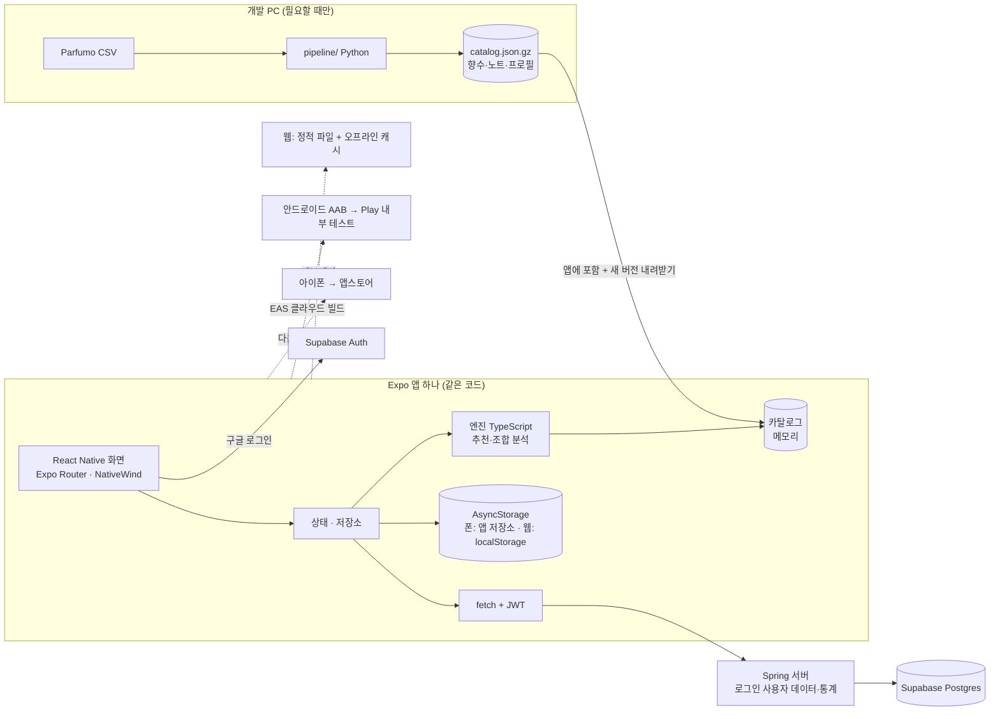
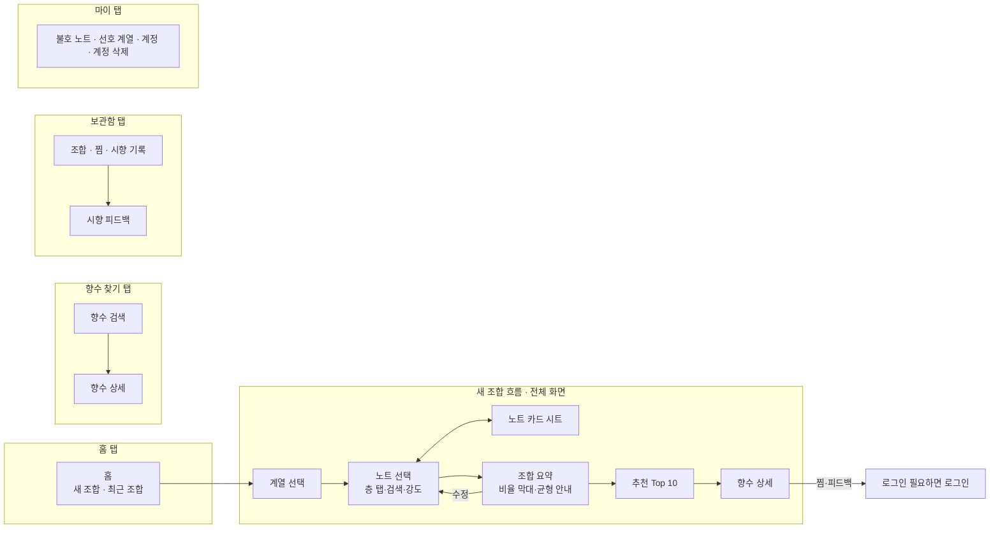

# scent-studio 설계 (1차, 보강판)

> 작성: 2026-10-30 · /build-app 2단계 결과물. 같은 날 안드로이드 전용(D안)으로 바꾸고, 실제 데이터로 실사·시험한 결과를 반영해 보강했다.
> **2026-10-31 사장 결정: 웹 + 안드로이드 + 아이폰으로 바꾸고 E안(Expo, React Native)을 골랐다.** 1·2·3·4·10·14·15·16·17절을 고쳤다. 5~9절(데이터·엔진 명세)은 그대로다.
> 기술 규칙은 CLAUDE.md "팀별 기본 기술"을 따른다(프론트엔드 React 계열 = React Native, 디자인 Tailwind = NativeWind). Python은 화면 뒤에서 한 번씩 돌리는 데이터 작업에만 쓴다.
> **저장소 밖 문서와 내용이 다르면 이 문서가 기준이다.**

## 0. 보강에서 바뀐 것 (사장 검토용 요약)

### 0-1. 실제 데이터를 열어 보고 알게 된 것 (5절에 숫자)
- Parfumo 데이터의 어코드는 **비율 없이 이름만** 있고, 향수마다 거의 **5개로 고정**(90%)이며, 종류는 **21개**다. → "합 100으로 정규화된 강도"는 데이터에 없다. **순서로 비중을 매긴다**(1위 5 : 2위 4 : … : 5위 1).
- 기존 계산식대로 노트 프로필을 "그 노트가 든 향수들의 어코드 평균"으로 만들면, 모든 노트가 흔한 어코드(플로럴·스파이시·스위트)로 뭉개진다.
  - 실험: 레몬의 프로필 1위가 프레시 14 · 스파이시 12 · 시트러스 12로 거의 평평하고, 샌달우드는 1위가 **플로럴**이었다.
  - 맹점 조합(레몬 강 + 오스만투스 + 샌달우드 약)의 어코드에 **시트러스가 상위 5개에 없었다.** 기획서가 막으려던 문제가 그대로 생긴다.
  - **보정:** "평균보다 얼마나 더 많은가"(평균 초과분)로 프로필을 만든다. 그러면 레몬은 시트러스 45, 샌달우드는 우디 32가 1위가 된다. 맹점 조합은 플로럴 23 · 시트러스 22가 되고, 추천 상위 5개 모두에 시트러스가 들어간다. (8절)
- 추천 후보는 약 2.1만 개이고, 평가가 10건 이상인 것으로 거르면 약 1.4만 개다. 노트는 3,610종인데, 30개 이상 향수에 쓰인 노트는 536종뿐이다. → 입문자에게는 이 536종만 목록으로 보여 주고, 나머지는 검색으로 찾게 한다.

### 0-2. 설계에서 바꾼 것 (★ 사장 결정 — 2026-10-30 추천안대로 OK)
| # | 결정 | 추천 | 이유 |
|---|---|---|---|
| D1 | 추천 계산을 어디서 하나 | **앱 안에서** (서버는 로그인·저장·통계만) | 무료 서버는 15분 쉬면 잠들어 깨는 데 최대 1분 걸린다. 앱 안에서 계산하면 핵심 기능(조합 → 추천)이 **즉시, 인터넷 없이도** 된다. 카탈로그 파일은 압축해서 약 1MB로 작다(시험 측정 0.7MB + 노트 프로필). 계산 코드는 앱·서버가 함께 쓰는 Java 모듈 하나에 둔다 |
| D2 | 하단 탭 | **4개**(홈 · 향수 찾기 · 보관함 · 마이) + "새 조합 만들기"는 홈에서 시작하는 전체 화면 흐름 | 조합 → 요약 → 추천 → 상세는 한 줄로 이어지는 흐름이다. 지금처럼 추천 결과(S06)가 "향수 찾기" 탭에 있으면 뒤로 가기가 꼬인다 |
| D3 | 로그인 안 한 사람의 불호·선호 설정 | **폰에 저장해 바로 적용**, 로그인하면 서버로 합친다 | 입문자는 로그인 전에 써 본다. 불호 노트 필터는 추천 품질에 직접 영향을 준다 |
| D4 | 데이터 라이선스 | 1차는 **Play 내부 테스트(초대한 사람만)**까지. 정식 공개는 라이선스를 확인한 뒤 | Parfumo 데이터는 수집(스크래핑) 데이터이고 라이선스 표시가 없다 |

### 0-3. 기획서에 더한 것 (2026-10-30 requirements.md에 반영함)
- 마이(S11)에 **계정 삭제**를 둔다. Play 정책상 계정을 만들 수 있는 앱은 필수다. 웹에서 삭제를 요청하는 방법도 안내해야 한다.
- **개인정보처리방침 페이지**를 만든다(정적 페이지 하나, GitHub Pages).
- 성공 기준을 재려면 **사용 기록**(조합 시작·완료, 추천 보기 등)이 필요하다. 13절에서 최소한으로 설계했다.
- 추천 점수 옆에 "매우 비슷 / 비슷 / 참고" 같은 **말로 된 등급**을 함께 보여 준다(8-6절).

## 1. 고른 안: E안 — Expo(React Native) 앱 하나로 웹·안드로이드·아이폰 + Spring, 데이터 작업만 Python
> 2026-10-31: 사장이 "웹 + 안드로이드 + 아이폰"으로 바꾸고, 설계안 3개(A React 웹 + Capacitor 포장 / B Expo / C 서버가 추천 계산) 중 B(여기서는 E안)를 골랐다. 그 전(10-30)은 D안(Kotlin 안드로이드 전용).



| 영역 | 맡는 팀 | 기술 |
|---|---|---|
| 앱 화면 (웹·안드로이드·아이폰 공통) | 프론트엔드팀 | **Expo(React Native) + TypeScript**, 최신 안정 Expo SDK(정확한 버전은 4단계 계획에서 `NOTES.md`에). 화면 이동 Expo Router(탭 + 쌓기, 웹 주소도 자동), 웹은 react-native-web. 상태는 React 상태 + 작은 저장소 모듈(라이브러리 최소). 기기 안 저장 AsyncStorage(웹에서는 localStorage). 서버 호출 fetch |
| 넓은 화면(PC) | 프론트엔드팀 | 화면 너비 1024px 이상이면 하단 탭 → 왼쪽 메뉴, 목록·상세 나란히, 노트 카드는 옆 패널(같은 컴포넌트, 배치만 다름) |
| 오프라인 | 프론트엔드팀 | 폰 앱: 카탈로그를 앱에 넣음. 웹: 내보낸 정적 파일과 카탈로그를 서비스 워커로 캐시(Workbox) → 한 번 연 뒤 인터넷 없이 됨. "홈 화면에 추가"용 웹 앱 매니페스트 |
| 로그인 | 프론트엔드팀 + 백엔드팀 | 앱: Supabase JS 클라이언트(Auth만) + 구글 OAuth(PKCE, 웹·폰 같은 코드). 로그인 방법을 목록으로 두어 앱스토어 때 애플 로그인(Supabase 지원)을 한 줄 더하면 되게 한다. 서버: Spring Security가 Supabase JWT를 공개키(JWKS)로 검증 |
| 디자인 | 디자인팀 | `docs/DESIGN.md` + **NativeWind**(React Native용 Tailwind). 색·간격은 `tailwind.config.js` 토큰 한 곳. 시안 캡처는 Playwright로 웹 화면을 폰·PC 크기로 찍음 |
| 추천 엔진 | 백엔드팀 | **`app/src/engine/` 순수 TypeScript, 의존성 없음.** 8절 명세 그대로, Python 참조 엔진이 만든 같은 골든 파일로 결과가 같은지 확인. 1차에는 기기만 추천을 계산한다 |
| 서버 | 백엔드팀 | Java 21 + Spring Boot 4, Spring Web, Spring Data JPA, Flyway, Spring Security(OAuth2 Resource Server), springdoc-openapi |
| DB · 로그인 | 백엔드팀 | Supabase를 **Postgres 호스팅과 구글 로그인으로만** 사용. 앱은 DB에 직접 붙지 않는다(12절) |
| 데이터 정리 | 백엔드팀 | Python(기본 기능만, 설치 없음) (`pipeline/`) → 카탈로그 파일, 보고서, Python 참조 엔진 |
| 엔진 검증 | 백엔드팀 | `pipeline/evaluate.py` → `docs/engine_report.md` (설치 없음) |
| 빌드 | 공통 | 앱: npm(Expo). 안드로이드·아이폰 설치 파일은 **EAS Build(클라우드, 무료 한도)** — 이 PC에 Android Studio·맥이 없어도 됨. 서버: `backend/` Gradle |
| 테스트 | QA팀 | 14절 |

### 1-1. 이미 만든 것 처리 (2026-10-31)
| 만든 것 | 처리 |
|---|---|
| `pipeline/` (Python 데이터 정리·참조 엔진·평가), 골든 파일, 가짜 데이터(`tests/fixtures/`) | **그대로 쓴다** |
| 승인 테스트 목록 40개(`tests.md`) | 내용 그대로. 안드로이드 전용 표현만 웹·폰 공통으로 바꿔 3단계에서 **바뀐 항목만 재승인** |
| Kotlin 앱(`app/`의 Kotlin 코드, Robolectric 승인 테스트 40개, Gradle 앱 모듈) | 재승인 뒤 지운다. 테스트는 Playwright로 다시 쓴다 |
| Java 엔진(`engine/`) | TypeScript로 옮긴 뒤 지운다(1차 서버는 추천을 계산하지 않음). 옮길 때 Java 골든·성질 테스트를 그대로 TypeScript로 옮긴다 |

## 2. 버린 안과 이유
| 안 | 내용 | 버린 이유 |
|---|---|---|
| A | React 웹 + Tailwind, Capacitor로 포장해 Play·앱스토어 (10-31 Claude 추천) | 사장이 E안을 고름. 앱 안의 화면이 웹 화면이라 폰 조작감이 진짜 앱보다 떨어지고, 아이폰 앱스토어 빌드에 맥이 필요 |
| C | React 웹 + Spring이 추천 계산(Java 엔진 재사용) | 무료 서버가 잠들면 첫 추천에 최대 1분, 인터넷 없으면 핵심 기능이 멈춤, 웹 주소만 감싼 앱은 앱스토어 심사 위험 |
| D | Kotlin + Compose 안드로이드 전용 (10-30에 고름) | 아이폰·웹 사용자가 못 씀 (10-31 사장 결정) |
| 서버 Python(FastAPI) | Expo + FastAPI | 작업장 기본 기술(Spring)과 충돌 |

## 3. 디자인 방향과 앱 화면 원칙
> 2026-10-30 사장 결정: 사장이 준 컬러 시스템을 쓴다. Claude가 대비를 계산해 고친 4곳과 "계열 색 없음"은 사장이 OK했다.
> 디자인팀은 4단계 시작에 이 절을 바탕으로 `docs/DESIGN.md`(글꼴 크기·간격·컴포넌트 규칙)를 쓰고 시안 캡처로 검토받는다. **이 절과 DESIGN.md가 다르면 이 절이 기준이다.**

### 3-1. 컨셉
**니치 향수 브랜드 감성(딥티크·조 말론 계열).** 크림 바탕 + 딥 그린 기준색 + 골드 포인트 하나. 색은 적게, 채도는 낮게.
**고급스럽고 깔끔하게. 아기자기하거나 귀여운 느낌은 화면, 도형, 아이콘, 문구 어디에도 넣지 않는다.** 핑크·블루 같은 성별 코드 색은 쓰지 않는다.

### 3-2. 컬러 토큰
`tailwind.config.js`(NativeWind) 한 곳에 아래 이름으로 정의하고, 화면 코드에서는 토큰 이름으로만 쓴다(색 값 직접 쓰기 금지). 라이트·다크 둘 다 1차에 만든다(시스템 설정을 따름).

| 토큰 | 라이트 | 다크 | 쓰는 곳 |
|---|---|---|---|
| bg | `#F5F1E8` 크림 | `#141614` | 기본 배경 |
| surface | `#FBF9F4` 아이보리 | `#1D201D` | 카드, 시트 |
| surfaceAlt | `#EDE7DA` 진한 크림 | `#262A26` | 구분 영역, 입력창 |
| primary | `#1F3D2E` 딥 포레스트 그린 | `#8FAE98` | 주요 버튼, 헤더, **내 조합** 막대 |
| primaryHover | `#2B5240` | `#A3C0AB` | 누르는 중 |
| accent | `#B08D57` 앤티크 골드 | `#C9A66B` | **칠하는 용도만**: 선택됨 배경, "가장 비슷한 향수", **향수** 막대 |
| accentStrong ★ | `#866634` | `#C9A66B` | 골드 **글자·아이콘·선택 테두리** (라이트에서 원래 골드는 대비 2.7:1이라 따로 둠) |
| accentSoft | `#E8DCC4` | `#3A3226` | 골드 배경 틴트 |
| text | `#1C1C1A` | `#EFEDE6` | 본문 |
| textSub ★ | `#62625E` (원래 `#6A6A66`) | `#A3A39E` | 보조 글자. 입력창 위에서도 AA가 되도록 살짝 진하게 |
| onPrimary | `#F5F1E8` | `#141614` | primary 위 글자 |
| onAccent ★ | `#1C1C1A` | `#141614` | accent 위 글자 (다크에서 밝은 글자는 2.0:1이라 늘 진한 글자) |
| border | `#D9D2C3` | `#333833` | 구분선 (장식용. 이것만으로 뜻을 전하지 않음) |
| noteTop | `#A8B5A0` 세이지 | 같음 | 탑 칩·그래프만 |
| noteMiddle | `#C9A9A0` 더스티 로즈 | 같음 | 미들 칩·그래프만 |
| noteBase | `#7A5C48` 우드 브라운 | 같음 | 베이스 칩·그래프만 |
| onNoteTop / onNoteMiddle ★ | `#1C1C1A` | `#141614` | 탑·미들 칩 위 글자 (8:1 안팎) |
| onNoteBase ★ | `#F5F1E8` | `#EFEDE6` | 베이스 칩 위 글자 (5:1 이상) |

★ = Claude가 대비 계산(WCAG)으로 더하거나 고친 것. 나머지는 사장이 준 값 그대로다.

### 3-3. 색 쓰는 규칙
- 화면 비율: 배경·서피스 70% · primary 20% · accent 10% 이하
- 골드는 "선택됨", "가장 비슷한 향수" 같은 핵심 1~2곳에만 쓴다
- **계열 색은 두지 않는다.** 계열(시트러스, 우디 …)은 늘 글자로 보여 준다
  - 어코드 비교 막대: 내 조합 = primary, 향수 = accent. 두 색만 쓰고, 막대마다 어코드 이름과 %를 글자로 함께 쓴다
  - 향수 카드: 브랜드·이름 + 상위 어코드 3개를 글자 칩(테두리만 있는 칩)으로 보여 준다
- 노트 색 3개는 탑·미들·베이스 구분에만 쓴다(칩, 피라미드, 그래프). 버튼에는 쓰지 않는다
- 그라데이션은 쓰지 않는다. 그림자는 아주 옅은 한 단계만, 되도록 1dp 선으로 구분한다
- 글자 대비는 WCAG AA(4.5:1, 큰 글자 3:1) 이상. 막대처럼 대비가 낮은 그래픽에는 반드시 글자를 함께 쓴다
- **색만으로 뜻을 전하지 않는다**(색약 사용자, 화면 읽기 TalkBack·VoiceOver·스크린 리더). 선택 상태는 색 + 테두리 또는 체크 표시로 나타낸다

### 3-4. 모양과 분위기 (고급스럽고 깔끔하게)
| 항목 | 이렇게 | 하지 않을 것 |
|---|---|---|
| 모서리 | 작게: 카드·시트·입력창·버튼 4dp, 칩 2dp | 알약 모양 버튼, 크게 둥근 카드, 원형 버블 |
| 선 | 1dp 가는 선으로 영역을 나눈다 | 두꺼운 테두리, 진한 그림자로 띄우기 |
| 아이콘 | 얇은 선 아이콘 한 종류(Material Symbols Outlined, 가는 굵기) | 채워진 통통한 아이콘, 이모지, 여러 스타일 섞기 |
| 그래픽 | 막대는 얇게(6~8dp), 끝은 각지게. 노트 피라미드는 선과 글자로 | 일러스트, 캐릭터, 스티커, 향수병 그림, 반짝이 효과 |
| 글꼴 | 제목은 세리프(명조 계열), 본문은 깔끔한 고딕. 영문 작은 라벨(TOP · MIDDLE · BASE)은 대문자 + 넓은 자간. 숫자는 폭이 같은 숫자 | 둥글고 귀여운 글꼴, 손글씨 글꼴 |
| 여백 | 넉넉하게: 화면 좌우 24dp, 8dp 단위 간격. 한 화면에 강조는 하나 | 화면을 꽉 채운 카드 격자, 여러 색 배지 |
| 움직임 | 150~250ms 부드러운 페이드·슬라이드 | 통통 튀는 애니메이션, 흔들기, 축하 효과 |
| 빈 화면 | 차분한 문장 한 줄 + 버튼 하나 | 일러스트, 귀여운 캐릭터 |
| 문구 | 차분한 존댓말. "데이터상 유사도", "메인 테마 추정치"처럼 단정하지 않는 말 | 느낌표 남발, 이모지, 유행어 |

- 글꼴은 디자인팀이 DESIGN.md에서 정한다. 앱에 넣는 글꼴은 무료 라이선스(OFL 등)만 쓴다(후보: 제목 Noto Serif KR 또는 마루 부리, 본문 Pretendard)

### 3-5. 공통 원칙
- 단위 dp는 웹에서 같은 값의 px로 쓴다(React Native는 dp, 웹은 CSS px로 자동 대응)
- 누르는 곳은 최소 48dp(아이폰 기준 44pt보다 큼). 글자 크기를 200%로 키워도 화면이 깨지지 않는다
- 넓은 화면(1024px 이상)은 하단 탭 대신 왼쪽 메뉴, 목록·상세 나란히. 본문 폭은 너무 넓어지지 않게 최대 폭을 둔다
- 모든 화면에 네 가지 상태를 그린다: 불러오는 중 · 내용 있음 · 비어 있음 · 오류(다시 시도)
- 시안과 화면 회귀 확인은 Playwright 캡처(웹 화면)로 한다: 화면마다 라이트·다크 × 작은 폰(360)·큰 폰(412)·PC(1280) + 글자 200%

## 4. 폴더 구조
```
apps/scent-studio/
├── HANDOFF.md
├── docs/            requirements.md, spec.md, design.md, reference.md, tests.md, plan.md, DESIGN.md, NOTES.md, review.md
├── app/             Expo 앱 (웹·안드로이드·아이폰 공통, TypeScript)
│   ├── app/            Expo Router 화면 (탭: index·search·library·my, 흐름: blend/*, perfume/[key])
│   ├── src/
│   │   ├── engine/     순수 TS 엔진 (추천·조합 분석·균형 안내) — React·Expo를 모름
│   │   ├── catalog/ blend/ user/ auth/ events/ ui/(components, theme)
│   │   └── strings.ko.ts   모든 화면 문구
│   ├── assets/catalog/ catalog.json.gz (파이프라인이 만듦, 커밋 안 함)
│   ├── tests/
│   │   ├── acceptance/  승인 목록 (Playwright, 웹으로 내보낸 앱을 실제 브라우저로 조작)
│   │   ├── unit/        엔진 골든·성질, 저장소 로직 (Vitest)
│   │   └── screens/     디자인 캡처 (Playwright)
│   └── tailwind.config.js, app.json, eas.json, package.json
├── backend/         Spring Boot (Gradle 별도 빌드)
│   └── src/main/resources/db/migration/   Flyway SQL
├── pipeline/        Python: fetch, build_catalog, engine_ref, make_golden, evaluate, manual/*.csv, data/raw/(커밋 안 함)
└── tests/
    ├── run.sh       빠른 테스트 전체 (HANDOFF의 테스트 명령)
    ├── fixtures/    가짜 Parfumo CSV, 노트 한글명
    └── golden/      recommend_cases.json (Python 참조 엔진이 만든 기대 결과)
```
- 경로는 모두 앱 폴더 기준 상대 경로다. 비밀값(DB 주소, Supabase 서비스 키, EAS 토큰)은 `.env`에 두고 `.env.example`에는 이름만 적는다. 앱에 들어가는 Supabase 공개 키는 비밀이 아니지만 12-1절대로 막는다.
- **이 저장소는 공개 저장소다.** 원본 CSV와 그것으로 만든 카탈로그 파일은 커밋하지 않는다. 다른 컴퓨터에서는 `pipeline/fetch.py`가 원본을 받아 다시 만든다. 테스트용 카탈로그는 **가짜 향수**로 만든다.

## 5. 데이터 실사 결과 (2026-10-30, Parfumo TidyTuesday 2024-12-10 `parfumo_data_clean.csv`)
| 항목 | 값 | 설계에 미친 영향 |
|---|---|---|
| 전체 향수 | 59,325 | |
| 어코드 있음 / 탑·미들·베이스 모두 있음 | 32,225 / 31,103 | |
| 추천 후보 (3층 모두 + 노트 3개 이상 + 어코드 있음) | 21,229 | |
| 그중 평가 10건 이상 | 14,089 | 후보 최소 평가 수 10 (설정값) |
| 어코드 종류 | 21개 + 잘못 들어간 값 "Main Accords" 10건 | 92개가 아니라 21차원. 잘못된 값은 버린다 |
| 향수당 어코드 수 | 5개 89% · 4개 5% · 그 이하 6% | 순위 비중(5:4:3:2:1)을 쓴다 |
| 어코드 강도·비율 | **없음** (이름 목록만) | 위와 같음. 목록이 진한 순서라는 가정은 M0에서 사이트 20건과 대조해 확인한다 |
| 노트 종류 (후보 안) | 3,610 · 30개 이상 향수에 쓰임 536 · 5개 이상 1,475 | 노트 공개 범위 (7절 8번) |
| 이름이 겹치는 노트 | cedar / cedarwood, musk / white musk 등 | 별칭 표(`aliases.csv`)로 합칠지 사람이 결정 |
| 같은 브랜드·같은 이름 중복 | 146건 | 하나로 합친다 (7절 4번) |
| 향수가 많은 브랜드 | Guerlain 305, Avon 215, Al Haramain 203 | 상위 10개 안에서 한 브랜드 최대 2개 |
| 라이선스 | 표시 없음 (Kaggle 수집 데이터, TidyTuesday 정리본) | D4 |

**FragDB는 1차에 꼭 필요하지 않다.** 노트 계열은 데이터에서 계산하고(7절 7번) 한글명은 직접 만든다(7절 10번). FragDB 무료 샘플은 한글명 초안의 참고로만 쓴다.

## 6. 계열과 어코드 (모든 팀 공통 표, 초안 — M0에서 확정)
사용자가 고르는 **계열 10개**를 프래그런스 휠 순서(`wheel_order`, 원형이라 10번 다음은 1번)로 둔다. 휠에서 이웃한 계열은 잘 어울린다고 안내한다.

| wheel_order | code | 이름 | 이 계열로 묶는 Parfumo 어코드 |
|---|---|---|---|
| 1 | citrus | 시트러스 | Citrus |
| 2 | fruity | 프루티 | Fruity |
| 3 | floral | 플로럴 | Floral |
| 4 | soft | 머스크·파우더리 | Powdery, Creamy, Synthetic, Animal |
| 5 | sweet | 스위트·구르망 | Sweet, Gourmand |
| 6 | spicy | 스파이시 | Spicy |
| 7 | amber | 앰버·레진 | Oriental, Resinous |
| 8 | woody | 우디 | Woody, Smoky, Leathery, Earthy, Chypre |
| 9 | green | 그린·아로마틱 | Green, Fougère |
| 10 | fresh | 프레시·아쿠아틱 | Fresh, Aquatic |

어코드 21개는 각각 한글명과 위 계열 하나를 가진다. 계열과 어코드에는 색을 두지 않는다(3-3절).

## 7. 데이터 파이프라인 (Python, 사람이 필요할 때 실행 → 카탈로그 파일)
1. **받기** `fetch.py`: 원본 CSV를 `pipeline/data/raw/`에 받고, 받은 날짜와 해시를 `report.md`에 적는다
2. **정리**: 목록을 쉼표로 나누고, 소문자·악센트·공백을 정리하고, 잘못된 어코드 값과 원본에 섞인 실재하지 않는 노트 이름(`manual/junk_notes.csv`, 30개)을 버리고, `aliases.csv`로 별칭을 대표 노트로 합친다 → 별칭 표에 없는 비슷한 이름 후보는 `unmapped_notes.csv`에 모은다
3. **후보 표시**: 3층 모두 있음, 노트 3개 이상, 어코드 1개 이상, 평가 10건 이상
4. **중복 합치기**: 같은 브랜드에서 농도 단어(EDT, EDP, Eau de …)를 뗀 이름이 같으면 평가 수가 많은 하나만 남긴다
5. **향수 어코드 벡터**: 목록 순서대로 5·4·3·2·1을 주고 합을 100으로 맞춘다(4개면 5·4·3·2를 100으로)
6. **노트 프로필** (8-2절 식): 평균 초과분 + 데이터가 적은 노트는 같은 계열 평균으로 끌어당기기
7. **노트 계열**: 프로필 1위 어코드의 계열. 상위 300개 노트는 사람이 훑어보고 이상한 것만 `note_family_override.csv`로 고친다
8. **노트 공개 범위**: 30개 이상 향수에 쓰인 노트(약 540종) = 목록에 보임 · 5~29개(약 940종) = 검색으로만 · 4개 이하 = 고를 수 없음(향수 데이터에는 남음)
9. **궁합 노트**: 같은 향수에 함께 나오는 정도(정규화 PMI, 흔한 노트·드문 노트로 쏠리지 않음), 함께 나온 횟수 20번 이상, 목록에 보이는 노트 중 상위 3개
10. **한글명·설명**: 고를 수 있는 노트(약 1,500종)의 한글명 초안을 만들고 사람이 `notes_ko.csv`에서 검토한다. 한 줄 설명은 목록에 보이는 노트 중 상위 300개만 쓰고, 나머지는 계열 공통 문구를 쓴다
11. **카탈로그 파일** `build_catalog.py`: `catalog.json.gz`(버전 번호, 계열, 어코드, 노트+프로필+궁합, 향수, 출처 문구) → `app/src/main/assets/`와 서버 배포 폴더에 둔다
12. **보고서** `report.md`: 후보 수, 미매핑 비율(5% 이하가 기준), 계열별 노트 수, 중복 합친 수
13. **골든 파일** `make_golden.py`: 가짜 카탈로그로 Python 참조 엔진을 돌려 `tests/golden/recommend_cases.json` 생성

## 8. 추천 엔진 명세 v2 (Python 참조 엔진과 Java `engine`이 **똑같이** 따른다)
기호: 어코드 집합 A(21개), 후보 향수 집합 P(N개), 노트 n을 가진 후보 수 df(n).

### 8-1. 향수 어코드 벡터
`a_p[x]` = 7절 5번의 순위 비중 (합 100). 전체 평균 `g[x] = (1/N) Σ_p a_p[x]`.

### 8-2. 노트 프로필 (파이프라인이 미리 계산해 카탈로그에 넣음)
1. 평균: `m_n[x]` = n을 가진 후보들의 `a_p[x]` 평균
2. 평균 초과분: `e_n[x] = max(0, m_n[x] − g[x])`
3. 끌어당기기: `e'_n = (df(n)·e_n + K·f_c) / (df(n) + K)`. K = 20, `f_c` = 같은 계열 노트들의 `e_n`을 df로 가중 평균한 것. (노트의 계열은 7절 7번 → 계열 계산에는 끌어당기기 전 `e_n`을 쓴다)
4. 합 1로 맞춘다. 모두 0이면 `f_c`를 쓴다

- 향수 key는 상품 페이지 주소의 `/Perfumes/` 뒤 부분에서 `/`를 `:`로 바꾼 것 (원본의 Number는 브랜드마다 겹쳐서 쓸 수 없음)

### 8-3. 조합 벡터와 화면 비율
- 고른 노트 `(n, 층, 강도 s ∈ {0.5, 1.0, 1.5})`마다 `b = Σ s · λ_층 · e'_n`. **λ_층은 1차에 모두 1.0**(탑 0.8 · 베이스 1.2 같은 층 가중은 노트북에서 시험만 한다)
- 화면용 비율: `b / sum(b) × 100`을 반올림(0.5 올림)해 1% 이상인 어코드만 큰 순서로. 합이 100이 아니면 가장 큰 항목에서 맞춘다(표시 전용)

### 8-4. 점수
1. **후보:** 7절 3·4번을 통과한 향수 중 불호 노트를 어느 층에도 갖지 않은 것
2. **어코드 유사도:** `accord_sim = cos(a_p, b)`. 하나라도 0벡터면 0
3. **노트 일치도:** 고른 노트마다 `w_n = ln(1 + N/df(n))`. 같은 층에 있으면 1.0, 다른 층에만 있으면 0.5, 그 노트는 없지만 같은 계열 노트가 있으면 0.3, 없으면 0. `note_match = Σ w_n·c_n / Σ w_n`
4. **취향 적합도:** `pref = Σ_{x의 계열 ∈ 선호 계열} a_p[x] / 100`
5. **점수:** 선호 계열이 있으면 `0.45·accord_sim + 0.45·note_match + 0.1·pref`, 없으면 `(0.45·accord_sim + 0.45·note_match) / 0.9`
   - 2026-10-30 사장 결정: 기획의 60/30/10에서 45/45/10으로 바꿨다. 실제 데이터에서 60/30은 "향수의 노트를 그대로 넣으면 그 향수가 3위 안"이 9/20, 45/45는 15/20이었고 맹점 조합은 둘 다 5/5였다(`docs/engine_report.md`). `engine_version` 2

### 8-5. 정렬과 다양성
1. `round(점수 × 1e9)` 내림차순 → 같으면 평가 수 내림차순 → 향수 key 오름차순 (반올림은 0.5에서 올림. Java 정렬이 깨지지 않게 "차이 1e-9 이하"를 이렇게 정의)
2. 위에서부터 담되 **농도만 다른 같은 향수(같은 `group`)는 하나만**(점수가 가장 높은 것), **한 브랜드는 최대 2개**까지만 담는다(넘치면 건너뛰고 다음 향수). k개(기본 10)를 채우면 끝
   - `group` = 이름에서 브랜드·연도·농도(Eau de Parfum, Profumo 등)를 뺀 것. Intense·Elixir처럼 이름에 남는 말은 다른 향수로 본다(2026-10-30 사장 요청: 6번 평가 조합에 Mediterraneo가 세 버전 나옴). 검색에서는 버전마다 따로 보인다

### 8-6. 반환과 설명
향수 key, score, accord_sim, note_match, 등급, 그리고 "왜 비슷한지":
- `shared_accords`: `min(a_p 비율, b 비율)`이 큰 어코드 상위 3개와 양쪽 %
- `matched_notes`: 일치한 노트와 층(같은 층 / 다른 층 / 같은 계열)
- `missing_notes`: 향수에는 있고 조합에는 없는 노트 중 df가 큰 순서로 최대 3개
- `등급`: 점수 0.85 이상 "매우 비슷", 0.75 이상 "비슷", 그 아래 "참고". 기준값은 노트북에서 점수 분포를 보고 정한다(시험에서는 중앙값 약 0.5, 상위권 0.85~0.9)

### 8-7. 조합 균형 안내 (경고가 아니라 안내 문구, 엔진이 판단하고 화면은 문구만 고른다)
| 코드 | 조건 | 안내 예 |
|---|---|---|
| EMPTY_LAYER | 비어 있는 층이 있음 | "베이스가 비어 있어 잔향이 가볍게 느껴질 수 있어요" |
| ONE_FAMILY | 노트 2개 이상이 모두 한 계열 | "한 계열로만 이루어져 단조로울 수 있어요. 이웃 계열(○○)을 더해 보세요" |
| DOMINANT | 조합 비율 1위 어코드가 60% 이상 | "○○ 느낌이 아주 강한 조합이에요" |
| FAR_FAMILIES | 고른 노트의 계열이 딱 2개이고 휠 거리가 4 이상 | "대비가 큰 조합이에요. 사이를 잇는 ○○ 계열을 더하면 부드러워져요" |

### 8-8. 숫자와 설정
- 계산은 모두 double. 가중치(0.45/0.45/0.1, 1.0/0.5/0.3), K, 최소 평가 수, 브랜드 상한, 등급 기준은 `EngineParams` 한 곳에만 둔다. 바꿀 때는 Python·Java·골든 파일을 함께 바꾸고 `engine_version`을 올린다
- 성능 목표: 중급 폰(앱·모바일 브라우저 모두)에서 추천 1회 300ms 이하, 카탈로그 불러오기 1.5초 이하(후보 1.4만 × 21차원이라 여유 있음). 웹에서 계산이 화면을 멈추면 Web Worker로 옮긴다
- TypeScript 엔진의 숫자는 JS number(=double)라 Python과 같은 결과를 낸다. 반올림 규칙(0.5 올림)은 직접 함수로 쓴다

## 9. 화면 흐름 (D2 반영)

- 탭마다 뒤로 가기 기록을 따로 가진다(탭을 옮겨도 보던 자리가 남음)
- 새 조합 흐름에서 나가면 "임시 저장된 조합 이어 하기"가 홈에 뜬다
- 저장된 조합(S09)을 누르면 S05(요약)로 열리고, 거기서 다시 추천을 볼 수 있다

## 10. 앱 구조 (Expo, 웹·안드로이드·아이폰 공통)
- **층 나누기:** 화면(Expo Router 화면 + 컴포넌트) → 화면별 훅(상태 계산) → 저장소 모듈(`catalog`, `blendDraft`, `user`, `eventQueue`) → engine / AsyncStorage / fetch. 플랫폼마다 다른 것(로그인 창, 오프라인 캐시)은 `*.web.ts` / `*.native.ts` 파일로만 나눈다
- **카탈로그:** 앱에 넣은 `catalog.json.gz`를 시작할 때 읽는다(약 1MB, 읽는 동안 첫 화면을 보여 준다). 시작할 때 서버에 새 버전이 있으면 내려받아 다음 실행부터 쓴다(폰은 와이파이에서만). 해시를 확인하고 깨졌으면 넣어 둔 버전을 쓴다
- **오프라인(웹):** 서비스 워커가 앱 파일과 카탈로그를 캐시한다. 새 버전을 배포하면 다음 방문 때 "새 버전이 있어요 · 새로고침" 안내
- **조합 임시 저장:** 바뀔 때마다 AsyncStorage에 저장한다. 앱·브라우저를 껐다 켜도(폰에서 시스템이 앱을 정리해도) 그대로 돌아온다
- **로그인 전 설정(D3):** 불호·선호를 AsyncStorage에 저장해 바로 추천에 반영한다. 로그인하면 서버 값과 **합친다**(불호는 합집합, 선호는 서버 값이 없을 때만 기기 값)
- **인터넷:** 조합·추천·검색은 인터넷 없이 된다. 저장·찜·피드백은 인터넷이 필요하다. 3초가 넘으면 "서버를 깨우는 중이에요(최대 1분)"를 보여 주고 실패하면 "다시 시도"를 둔다. 실패한 저장을 몰래 쌓아 두지 않는다
- **로그인:** Supabase `signInWithOAuth`(구글, PKCE). 웹은 같은 창 이동, 폰은 시스템 브라우저 창 후 앱으로 돌아옴(딥링크 `scentstudio://`). 세션은 Supabase 클라이언트가 보관·자동 갱신(폰은 expo-secure-store). 모든 요청에 `Authorization: Bearer`. 401이면 한 번 갱신하고 다시 시도, 그래도 401이면 로그아웃 상태로. 로그인 방법은 목록(`providers = ['google']`)으로 두어 애플을 더하기 쉽게 한다
- **서버 주소:** `EXPO_PUBLIC_API_URL` 환경값(개발은 PC 주소, 배포는 HTTPS 주소). 코드에 박지 않는다
- **문구:** 모든 글자는 `src/strings.ko.ts`(한국어)에 둔다
- **출시 빌드:** EAS Build로 안드로이드 AAB(Play 앱 서명). 업로드 키는 EAS가 보관하고 사장 계정에 묶인다(커밋 금지). 아이폰은 다음 차수에 같은 방법(애플 개발자 계정 필요)

## 11. API (Spring Boot, `/api/v1`, JSON)
추천 계산과 검색은 앱 안에서 한다(D1). 서버는 로그인한 사용자 데이터, 카탈로그 배포, 통계만 맡는다.

| 메서드 · 경로 | 로그인 | 설명 | 화면 |
|---|---|---|---|
| GET /catalog/latest | — | `{version, sha256, size, url}` | 앱 시작 |
| GET /catalog/{version} | — | 카탈로그 파일(gzip) | 앱 시작 |
| GET /me | 필수 | 내 계정 정보 | S11 |
| DELETE /me | 필수 | **계정 삭제**: 내 데이터 전부 + Supabase 계정 삭제 | S11 |
| GET·PUT /me/preferences | 필수 | 불호 노트 key 목록, 선호 계열 | S11, 로그인 직후 합치기 |
| GET·POST /blends, PUT·DELETE /blends/{id} | 필수 | 내 조합 (이름 바꾸기 포함) | S01, S05, S09 |
| GET /favorites, PUT·DELETE /favorites/{perfumeKey} | 필수 | 찜 | S07, S09 |
| GET·POST /feedback | 필수 | 시향 피드백 | S09, S10 |
| POST /events | 선택 | 사용 기록 묶음(최대 100개) | 13절 |

- 사용자 id는 **토큰에서만** 꺼낸다. 요청 본문이나 경로의 사용자 id는 믿지 않는다
- 조합 검증(서버에서도): 층당 최대 3개, 전체 최소 1개, 같은 노트는 한 번만, 강도 ∈ {0.5, 1.0, 1.5}, 노트 key는 현재 카탈로그에 있는 것만, 이름 40자, 메모 500자
- 오류 형식: `{"error": {"code": "NOTE_NOT_FOUND", "message": "..."}}`. 코드 목록은 `docs/api-errors.md`(4단계)
- 앱의 TypeScript 타입은 springdoc OpenAPI 문서에서 생성한다(openapi-typescript, 손으로 맞추지 않음)
- `/events`는 기기 하나당 분당 요청 수를 제한한다

## 12. 데이터 모델 (Postgres, 스키마 `app`)
카탈로그는 DB에 넣지 않는다(파일 하나가 원본). 사용자 데이터는 카탈로그가 바뀌어도 유지되게 **바뀌지 않는 key**(향수 = Parfumo 번호, 노트 = 정리된 영문 이름)로 가리킨다.

| 테이블 | 컬럼 |
|---|---|
| user_preferences | user_id(PK, Supabase uid), preferred_families text[], disliked_note_keys text[], updated_at |
| blends | id uuid, user_id, name, families text[], notes jsonb `[{note_key, layer, intensity}]`, created_at, updated_at |
| favorites | user_id, perfume_key, created_at (PK user_id+perfume_key) |
| tasting_feedback | id, user_id, perfume_key, blend_id(선택), satisfaction 1~5, similarity 1~5, memo, tested_at, rank(선택), score(선택), engine_version, catalog_version |
| events | id, install_id uuid, user_id(선택), name, props jsonb, app_version, occurred_at, received_at |

- 피드백에 그때의 순위·점수·엔진 버전을 함께 남긴다 → 4차 "피드백으로 가중치 조정"의 재료
- 모든 사용자 테이블에 `user_id` 인덱스. 계정 삭제는 한 트랜잭션에서 사용자 행을 모두 지운다(events의 user_id는 null로)

## 12-1. 보안·개인정보·Play 정책
- **Supabase 직접 접근 막기:** 앱에 들어가는 Supabase 공개 키(anon key)는 누구나 꺼낼 수 있다. 테이블을 공개 API에 노출되지 않는 `app` 스키마에 두고, 모든 테이블에 RLS를 켜고 정책을 두지 않는다(= 공개 API로는 아무것도 못 읽음). Spring만 DB 계정으로 접근한다
- 서비스 키(계정 삭제에 필요)는 서버 `.env`에만 둔다
- JWT 검증: 서명(JWKS), `iss`, `aud=authenticated`, 만료를 확인한다
- 사용 기록에는 광고 ID를 쓰지 않는다. 앱 설치 때 만든 무작위 `install_id`만 쓴다
- Play 준비물: 개인정보처리방침 URL, 데이터 보안 양식(수집: 이메일·사용 기록·피드백 메모), 앱 안 계정 삭제 + 웹 삭제 요청 안내 URL. 두 페이지는 GitHub Pages 정적 페이지로 만든다
- 화면에 데이터 출처(Parfumo)를 표시한다

## 13. 사용 기록 (성공 기준 측정용, 최소한만)
| 이벤트 | 언제 | props |
|---|---|---|
| app_open | 앱 시작 | — |
| blend_started | 새 조합 흐름 시작 | — |
| blend_summary_viewed | S05 도착 | note_count, warnings |
| recs_viewed | S06 도착 | engine_version, catalog_version |
| perfume_opened | S07 열기 | from(recs/search), rank |
| blend_saved / favorite_added / feedback_submitted | 각 동작 성공 | — |

- 기기의 AsyncStorage 대기열에 쌓았다가 30초마다 또는 앱이 백그라운드로 가거나 탭이 가려질 때 보낸다. 인터넷이 없으면 다음에 보낸다(최대 1,000개, 넘으면 오래된 것부터 버림)
- 기획서 성공 기준 계산: 조합 완성률 = recs_viewed / blend_started, 저장률 = blend_saved / recs_viewed, 재방문율 = 7일 안에 app_open이 2일 이상인 install_id 비율. 계산 SQL은 `docs/metrics.sql`(4단계)

## 14. 테스트 설계 (2026-10-31 E안에 맞게 바꿈)
| 종류 | 어디서 | 내용 | 훅에서 돌림 |
|---|---|---|---|
| **승인 목록** | `app/tests/acceptance/` **Playwright** | 사장 승인 대상. 앱을 웹으로 내보내 실제 브라우저(크롬)에서 사람처럼 누른다. 폰 크기와 PC 크기 화면. 카탈로그는 가짜 카탈로그, 서버는 Playwright가 가로챈 가짜 응답, 로그인은 "로그인된 상태" 흉내 | ✅ |
| 엔진 골든 | `app/tests/unit/` Vitest | 가짜 카탈로그 + Python이 만든 기대 결과와 **순위가 같고 점수 차 1e-9 이하** | ✅ |
| 엔진 성질 | 같은 곳 | 비율 합 100, 불호 노트 든 향수가 절대 안 나옴, 같은 입력 같은 결과, 브랜드 최대 2개, 노트 0개면 오류 | ✅ |
| 저장소 로직 | 같은 곳 | 층당 3개 제한, 임시 저장 복원, 로그인 후 설정 합치기, 사용 기록 대기열 | ✅ |
| 서버 | `backend/src/test/` JUnit + Spring Boot Test + 내장 Postgres(zonky, Docker 불필요) | 토큰 없으면 401, 남의 조합을 못 읽고 못 지움, 검증 실패 400, 계정 삭제 후 데이터 없음 | ✅ |
| 화면 캡처 | `app/tests/screens/` Playwright | 화면마다 라이트·다크 × 360·412·1280 + 글자 200%. 디자인 검토 시안이자 화면 회귀 확인 | ✅ |
| 폰 앱 확인 | 안드로이드 실제 폰 또는 에뮬레이터 (EAS로 만든 설치 파일) | 핵심 흐름(새 조합 → 추천 → 상세), 앱 재시작 후 임시 저장 복원, 비행기 모드에서 추천. 6단계 QA 보고 전에 Maestro 흐름 파일로 돌리거나 사장이 직접 | ❌ |
| 사장 직접 | 실제 폰(안드로이드 앱, 아이폰 사파리) | 구글 로그인, 저장·찜·피드백, 계정 삭제, 아이폰 "홈 화면에 추가" (구글 로그인은 자동 테스트가 안 됨) | ❌ |

- **승인 목록 후보:** ① 계열 고르고 층마다 노트를 골라 요약에서 비율 막대 합이 100% ② 층당 4번째 노트는 안 들어감 ③ 추천 10개가 점수 순으로 나오고 각각 등급·공통 어코드·일치 노트가 보임 ④ 불호 노트를 정하면 그 노트가 든 향수가 추천에서 사라짐(로그인 없이도) ⑤ 비로그인으로 저장을 누르면 로그인 화면으로 감 ⑥ 로그인 상태로 저장·찜·피드백하면 보관함에 보임 ⑦ 앱을 껐다 켜도 만들던 조합이 남음 ⑧ 인터넷이 없어도 조합과 추천이 됨 ⑨ 작은 폰과 글자 200%에서 버튼이 잘리지 않음 ⑩ 계정 삭제 후 보관함이 빔
- **엔진 합격 기준** (노트북, 실제 카탈로그, 백엔드팀 사장 검토 때 함께 보여 줌):
  | 항목 | 기준 |
  |---|---|
  | 재현: 실제 향수 20개의 노트를 그대로 넣으면 그 향수가 Top 3 | 15개 이상 (2026-10-30 사장 결정으로 16→15) |
  | 맹점: 레몬 강 + 오스만투스 중 + 샌달우드 약 | Top 5 중 4개 이상이 시트러스와 플로럴을 둘 다 가짐 (보정 후 시험에서 5/5) |
  | 블라인드 비교(가설 1): 조합 10개마다 어코드 중심 Top 5와 노트 중심 Top 5를 어느 쪽인지 숨기고 사장이 더 비슷한 쪽을 고름 | 어코드 중심이 6개 이상 |
  | 눈으로 평가: 조합 10개 × Top 5를 1~5점으로 | 평균 3.5 이상 |
  | 다양성: 조합 10개의 Top 10 전체에서 서로 다른 브랜드 수 | 40개 이상 |
- **전체 실행:** `tests/run.sh` = 파이프라인 pytest → `app`에서 `npx vitest run` → 웹 내보내기 + `npx playwright test` → `backend`에서 `./gradlew test`. HANDOFF 테스트 명령은 `bash tests/run.sh`. 5분을 넘으면 `NOTES.md`에 적고 내보내기 캐시부터 손본다

## 15. 4단계 구현 순서 (plan.md에 옮길 것, 관문을 못 넘으면 다음으로 가지 않음)
| 단계 | 팀 | 할 일 | 관문 |
|---|---|---|---|
| M0 | 백엔드 | 파이프라인 1~12, 어코드 순서 가정 확인(사이트 20건), 별칭·계열·한글명 표 초안 | 미매핑 5% 이하, 순서 가정 확인 |
| M1 | 백엔드 | Python 참조 엔진 + 노트북 → 합격 기준표, 등급 기준값 확정 | 14절 기준 통과 |
| M2 | 백엔드 | ~~Java `engine` 모듈~~(10-30 완료, 10-31 E안으로 교체) → **TypeScript 엔진** `app/src/engine/` + 같은 골든·성질 테스트(Vitest) | 골든·성질 테스트 통과 |
| ★ | 백엔드 | **사장 검토**: 저장할 데이터·기능 목록 + 엔진 합격 기준표 | OK |
| M3 | 백엔드 | Spring 서버: 보안, 사용자 API, 계정 삭제, 사용 기록, 카탈로그 배포 | 서버 테스트 통과 |
| ★ | 디자인 | **사장 검토**: DESIGN.md + Playwright 시안 캡처(폰·PC) | OK |
| M4 | 프론트 | 앱: 카탈로그·새 조합 흐름(S02→S06) 먼저 → S07·S08 → 로그인·보관함·마이 | 승인 목록 통과 |
| M5 | 프론트 | 사용 기록, 오류·빈 상태, 웹 오프라인·홈 화면 추가, EAS 안드로이드 빌드, 개인정보·삭제 안내 페이지 | 폰 앱 확인 통과 |

## 16. 배포·운영 (6단계, 공개는 사장이 `!` 한 줄로 실행)
| 부분 | 위치 | 메모 |
|---|---|---|
| API | Render (Docker) 무료 | 15분 쉬면 잠듦 → D1 덕에 저장·찜만 느려짐. JVM 메모리 상한 지정. 베타 중 불편하면 유료(월 약 7달러) |
| DB · 로그인 | Supabase 무료 | **7일 동안 아무 요청이 없으면 프로젝트가 일시 정지됨** → GitHub Actions 예약 작업이 하루 한 번 서버 상태 확인(DB까지 닿는 것)을 부른다 |
| 카탈로그 | 앱에 포함 + 서버에서 새 버전 배포 | 버전 번호와 해시 |
| 웹 | 앱 파일만 담은 공개 저장소 + GitHub Pages (`npx expo export -p web`) | HTTPS 주소 하나. 폰에서 "홈 화면에 추가" |
| 안드로이드 | EAS Build(클라우드) → Play Console **내부 테스트**(D4) | Expo 계정(무료)과 Play 개발자 계정(1회 25달러)은 사장이 직접 |
| 아이폰 (다음 차수) | EAS Build(클라우드, 맥 불필요) → 앱스토어 | 애플 개발자 계정(연 99달러), 애플 로그인 추가 |
| 안내 페이지 | GitHub Pages | 개인정보처리방침, 계정 삭제 요청 방법 |

## 17. 위험과 대응
| 위험 | 대응 |
|---|---|
| 데이터 라이선스 (수집 데이터, 표시 없음) | D4: 내부 테스트까지만. 공개 전 결정. 원본·카탈로그는 공개 저장소에 커밋하지 않음 |
| 어코드 순서 = 진한 순서라는 가정이 틀림 | M0에서 확인. 틀리면 모두 같은 비중(1/개수)으로 바꾸고 노트북을 다시 돌림 |
| 노트 프로필이 흔한 어코드로 뭉개짐 | 8-2절 평균 초과분 + 끌어당기기. 노트북에서 노트 20개의 프로필을 사람이 확인 |
| 21차원 × 5개라 비슷한 점수가 많음 | 노트 일치도·평가 수로 순서를 가르고, 등급으로 보여 줌 |
| Python과 Java 엔진이 어긋남 | 8절 명세 한 곳, 골든 테스트 |
| 유명·대형 브랜드만 상위에 몰림 | 브랜드 최대 2개, 다양성 기준 |
| 무료 서버 잠듦 / Supabase 일시 정지 | D1(핵심 기능은 서버 없이), 하루 한 번 깨우기 |
| 앱의 공개 키로 DB를 직접 읽음 | 12-1절 `app` 스키마 + RLS |
| 웹 내보내기 + Playwright가 느려 훅(5분) 초과 | 한 번만 내보내고 테스트를 나눠 돌림, 폰 앱 확인은 훅에서 뺌 |
| react-native-web에서 폰과 웹이 다르게 보임 | 승인 목록은 웹으로, 폰은 6단계 폰 앱 확인으로 따로 본다. 다른 부분은 `*.web.tsx`로만 나눈다 |
| 웹 주소만 감싼 앱이라 앱스토어 거절 | E안은 진짜 앱으로 빌드되고 데이터·계산이 앱 안에 있음 |
| 이 컴퓨터에 Android Studio가 없음 | EAS 클라우드 빌드라 필요 없음. 에뮬레이터로 확인하고 싶을 때만 설치 |
| 카탈로그가 커져 앱이 무거워짐 | 1.4만 개 기준 압축 약 1MB. 5MB가 넘으면 압축 형식(바이너리)으로 바꿈 |

## 18. 아직 정하지 않은 것
- (디자인 방향은 2026-10-30 확정, 3절)
- (D1~D4는 2026-10-30 추천안대로 확정)
- 노트 별칭 중 냄새가 다른 것(예: musk와 white musk)을 합칠지 → M0에서 `unmapped_notes.csv` 목록으로 사장에게 짧게 확인
