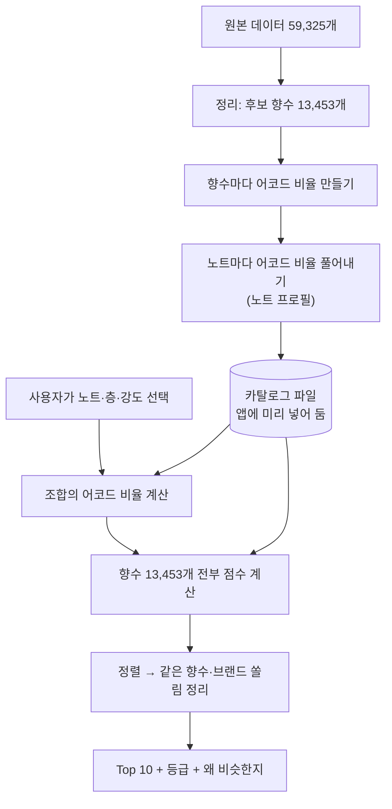

# 추천 엔진은 어떻게 계산하나

> 기준: 엔진 v6 · 후보 향수 13,453개. 코드(`pipeline/engine_ref.py`, `pipeline/build_catalog.py`)를 읽고 썼습니다.
> 예시 숫자는 실제 엔진으로 계산했고, 엔진 점수와 이 문서의 식으로 다시 계산한 값이 일치하는 것까지 확인했습니다. 다시 뽑는 방법: `py pipeline/experiments/explain_example.py`
> 블라인드 비교를 아직 답하지 않았다면 **11절(버전별 변화)은 답한 뒤에 읽어 주세요.** 예시 조합과 예시 향수는 블라인드 문서에 없는 것만 썼습니다.

## 1. 먼저 알아 둘 것

**이 엔진은 향을 맡거나 실제로 섞어 보지 않습니다.** 향 분자나 화학 반응도 계산하지 않습니다.

- 사람들이 향수 사이트(Parfumo)에 남긴 정보를 숫자로 바꿉니다. 어떤 향수에 어떤 노트가 들었고, 어떤 느낌(어코드)으로 분류됐는지입니다.
- 사용자가 고른 노트를 같은 방식의 숫자로 바꿉니다.
- 두 숫자가 얼마나 닮았는지 재서, 가장 닮은 실제 향수를 보여 줍니다.

그래서 "조합한다"는 말은 **노트마다 가진 느낌 비율을 더한다**는 뜻입니다. 실제로 그렇게 섞었을 때 나는 향을 예측하는 것은 아닙니다.

## 2. 전체 흐름



위쪽 절반은 데이터를 만들 때 한 번만 계산하고, 아래쪽 절반은 사용자가 조합할 때마다 계산합니다.

## 3. 후보 향수 고르기

| 단계 | 남은 수 |
|---|---|
| 원본 전체 | 59,325 |
| 탑·미들·베이스가 모두 있고, 노트 3개 이상, 어코드 1개 이상, 평가 10건 이상 | 14,089 |
| 같은 향수의 농도 중복 합치기 (303개 줄어듦) | 13,786 |
| 원본 데이터의 복사 오류 빼기 (333개 줄어듦) | **13,453** |

복사 오류는 브랜드가 다른데 노트·평가 수·어코드·조향사가 모두 같은 경우입니다. 뺀 목록은 `pipeline/copy_suspects.csv`에 남겨 두었습니다.

## 4. 향수를 숫자로 바꾸기

어코드는 **시트러스, 플로럴, 우디 같은 느낌 21가지**입니다. 원본에는 어코드 이름만 있고 비율이 없어서, 목록 순서대로 5·4·3·2·1을 주고 합이 100이 되게 맞춥니다.

예: Renato Balestra Argento의 어코드 목록은 프레시, 우디, 플로럴, 시프레, 스파이시입니다.

| 어코드 | 프레시 | 우디 | 플로럴 | 시프레 | 스파이시 | 나머지 16개 |
|---|---|---|---|---:|---:|---:|
| 비율 | 33.3 | 26.7 | 20.0 | 13.3 | 6.7 | 0 |

## 5. 노트를 숫자로 바꾸기 (노트 프로필)

노트에는 원래 어코드 정보가 없습니다. 그래서 그 노트가 든 향수들에서 거꾸로 풀어냅니다. 엔진에서 가장 중요한 단계입니다.

**단순 평균을 쓰지 않는 이유:** 시더우드가 든 향수들의 어코드를 그냥 평균 내면 함께 든 다른 노트의 느낌까지 섞여서, 1위가 우디가 아니라 스파이시로 나옵니다.

**그래서 함께 든 노트의 몫을 나눕니다:** "향수의 어코드 비율은 그 향수에 든 노트 프로필들의 평균과 비슷하다"고 놓고, 전체 향수에서 오차가 가장 작아지는 노트 프로필을 계산합니다(음수 없는 최소제곱, 400번 반복). 이렇게 하면 플로럴은 장미·자스민이 가져가고, 시더우드에는 시더우드 몫만 남습니다.

| 노트 | 단순 평균 상위 | 최종 프로필 상위 |
|---|---|---|
| 라임 | 프레시 18.2 · 시트러스 14.4 · 스파이시 11.5 | **시트러스 49.9 · 프레시 34.4** · 프루티 6.9 |
| 은방울꽃 | 플로럴 23.7 · 프레시 12.5 · 스위트 10.7 | **플로럴 48.5 · 프레시 25.5 · 그린 16.2** |
| 시더우드 | 스파이시 14.2 · 우디 13.3 · 프레시 12.5 | **우디 69.7 · 프레시 19.6** · 스파이시 9.8 |

데이터가 적은 노트는 따로 보정합니다.

- 향수 20개 미만에 나오는 노트: 특징이 부풀려지기 쉬워서, 같은 계열의 평균 프로필을 그대로 씁니다.
- 향수 20개 이상에 나오는 노트: 계열 평균과 섞습니다. `(나오는 향수 수 × 자기 값 + 20 × 계열 평균) ÷ (나오는 향수 수 + 20)`. 많이 나오는 노트일수록 자기 값에 가까워집니다.
- 향수 4개 이하에 나오는 노트: 고를 수 없습니다. 5~29개는 검색으로만, 30개 이상은 목록에서 고를 수 있습니다.

## 6. 조합을 숫자로 바꾸기

고른 노트의 프로필에 **강도**를 곱해서 모두 더합니다.

```
조합 = (노트1 프로필 × 강도) + (노트2 프로필 × 강도) + ...
강도: 약 0.5 · 중 1.0 · 강 3.0
```

예: 라임(탑) · 은방울꽃(미들) · 시더우드(베이스)

| 어코드 | 모두 중 | 시더우드만 강 |
|---|---:|---:|
| 우디 | 23.3% | **41.9%** |
| 프레시 | 26.5% | 23.8% |
| 시트러스 | 16.8% | 10.4% |
| 플로럴 | 16.2% | 9.7% |
| 그린 | 6.2% | 3.8% |
| 스파이시 | 3.3% | 5.9% |

"모두 중"의 프레시를 손으로 계산하면 (34.4 + 25.5 + 19.6) ÷ 3 = 26.5입니다.

화면에는 합이 100이 되도록 반올림하고 남는 차이를 1위 항목에 몰아주기 때문에, 표시값이 실제와 조금 다를 수 있습니다. 위 예의 프레시는 실제 26.5%인데 화면에는 28%로 나옵니다. 점수 계산에는 영향이 없습니다.

## 7. 향수마다 점수 매기기

불호 노트가 든 향수를 빼고, 남은 향수 전부에 두 가지 점수를 매겨 합칩니다.

### ① 어코드 유사도 (0~1)
조합과 향수의 어코드 비율이 **얼마나 같은 모양인지** 봅니다(코사인 유사도). 크기는 보지 않고 비율의 모양만 봅니다.

### ② 노트 일치도 (0~1)
고른 노트가 그 향수에 실제로 들어 있는지 봅니다.

| 그 향수에서 | 점수 |
|---|---:|
| 같은 층에 있음 | 1.0 |
| 다른 층에 있음 | 0.5 |
| 그 노트는 없지만 같은 계열 노트가 있음 | 0.3 |
| 없음 | 0 |

**드문 노트일수록 비중이 큽니다.** 비중은 `ln(1 + 후보 수 ÷ 그 노트가 든 향수 수)`입니다.

| 노트 | 든 향수 수 | 비중 |
|---|---:|---:|
| 라임 | 412 | 3.516 |
| 은방울꽃 | 1,334 | 2.406 |
| 시더우드 | 3,897 | 1.493 |

### ③ 합치기

```
선호 계열 없음:  점수 = (0.35 × 어코드 유사도 + 0.55 × 노트 일치도) ÷ 0.9
선호 계열 있음:  점수 = 0.35 × 어코드 유사도 + 0.55 × 노트 일치도 + 0.1 × 선호 계열 비중
```

### 손으로 계산해 보기
조합: 라임(탑) · 은방울꽃(미들) · 시더우드(베이스), 모두 중. 향수: Renato Balestra Argento

1. 어코드 유사도 = **0.8752** (21개 어코드 전체로 계산)
2. 노트 3개가 모두 같은 층에 있으므로 노트 일치도 = (3.516×1 + 2.406×1 + 1.493×1) ÷ (3.516 + 2.406 + 1.493) = **1.0000**
3. 점수 = (0.35 × 0.8752 + 0.55 × 1.0000) ÷ 0.9 = **0.9515**

일부만 맞는 경우(가상의 향수): 라임은 같은 층에 있고, 은방울꽃은 없지만 플로럴 계열 노트가 있고, 시더우드 쪽은 해당 없음

노트 일치도 = (3.516×1.0 + 2.406×0.3 + 1.493×0) ÷ 7.415 = **0.5715**

## 8. 순위에서 Top 10까지

1. 점수가 높은 순서로 정렬합니다. 같으면 평가 수가 많은 쪽, 그래도 같으면 향수 key 순서입니다.
2. 위에서부터 담되, **농도만 다른 같은 향수는 하나만**, **한 브랜드는 최대 2개까지** 담습니다.
3. 10개가 차면 멈춥니다.
4. 등급을 붙입니다.

| 점수 | 등급 |
|---|---|
| 0.87 이상 | 매우 비슷 |
| 0.79 이상 | 비슷 |
| 그 아래 | 참고 |

이 기준값은 "향수의 노트를 그대로 넣었을 때 그 향수 자신이 받는 점수"의 중앙값과 하위 25%에서 왔습니다. 예전 엔진(v3) 때 잰 값이라 **지금 다시 재면 0.92 / 0.87**이고, 어느 값을 쓸지는 사장님 결정 대기 중입니다.

### 예시 결과: 라임 · 은방울꽃 · 시더우드 (모두 중)

| 순위 | 향수 | 점수 | 어코드 유사도 | 노트 일치도 |
|---:|---|---:|---:|---:|
| 1 | Renato Balestra — Argento | 0.9515 | 0.8752 | 1.0000 |
| 2 | Versace — V/S for Men | 0.9486 | 0.8678 | 1.0000 |
| 3 | Extró — Bay Rum | 0.9453 | 0.8592 | 1.0000 |
| 4 | Clive Christian — Mandarin | 0.9371 | 0.8382 | 1.0000 |
| 5 | Roja Parfums — Elysium Eau Intense | 0.9246 | 0.8061 | 1.0000 |

다섯 개 모두 노트 일치도가 1.0이라, **이 조합의 순위는 어코드 유사도만으로 갈렸습니다.**

## 9. 입력을 바꾸면 숫자가 어떻게 움직이나

같은 조합을 조금씩 바꿔 실제로 돌린 결과입니다.

| 바꾼 것 | 결과 |
|---|---|
| **시더우드만 강** | 우디 23.3% → 41.9%. Superdry Steel이 2위로 새로 들어오고 Extró가 5위 밖으로 밀림. 1위 Argento는 0.9515 → 0.9445 |
| **모두 강** | 모두 중일 때와 **Top 10이 완전히 같음.** 비율 모양이 그대로이기 때문 |
| **라임과 시더우드의 층을 맞바꿈** | 어코드 비율은 그대로인데 노트 일치도 1.0000 → 0.6622. Argento는 0.9515 → 0.7450으로 "매우 비슷"에서 "참고"로 떨어짐 |
| **선호 계열을 우디로 설정** | Argento의 우디 계열 비중이 0.40인데 점수는 0.9515 → **0.8963으로 내려감** (아래 10절) |

여기서 엔진의 규칙 세 가지를 확인할 수 있습니다.

- **강도는 다른 노트와의 상대적인 비율만 바꿉니다.** 모두 올리면 아무 변화가 없습니다. 노트 일치도에는 강도가 쓰이지 않습니다.
- **층은 어코드 계산에 영향이 없습니다.** 탑·미들·베이스 가중치가 모두 1.0이고, 층은 노트 일치도에서만 쓰입니다.
- **층이 틀리면 점수가 크게 깎입니다.**

## 10. 어떻게 검증하고 있나, 그리고 한계

### 시험 현황 (`docs/engine_report.md`)

| 시험 | 하는 일 | 기준 | 현재 |
|---|---|---|---:|
| 재현 | 평가 많은 향수의 노트를 그대로 넣으면 그 향수가 Top 3에 나오나 | 20개 중 15개 | 20/20 |
| 어려운 재현 | 층마다 2개만 넣거나 노트 하나를 빼고 재현 | (참고) | 20/20, 20/20 |
| 맹점 | 시트러스·플로럴 조합에서 Top 5 중 둘 다 가진 향수 수 | 5개 중 4개 | 4/5 |
| 다양성 | 12개 조합의 Top 10에 나온 서로 다른 브랜드 수 | 40개 | 97 |
| 블라인드 | 사람이 두 엔진의 추천 목록을 비교해 고르기 | 조합의 60% | **답 대기** |
| 눈으로 평가 | 사람이 추천 결과에 1~5점 매기기 | 평균 3.5 | **답 대기** |
| 엔진 일치 | Python과 앱(TypeScript) 엔진 결과가 같은가 | 전부 일치 | 통과 |

**숫자 시험은 "계산이 일관되게 도는가"를 보는 것이지 "실제 향이 비슷한가"를 증명하지는 않습니다.** 재현 시험은 정답을 입력으로 넣는 쉬운 시험이라 변별력도 낮습니다. 사람의 판단이 들어가는 시험은 블라인드와 눈으로 평가뿐이고, 둘 다 아직 답이 없습니다. 블라인드도 시향이 아니라 향수 이름과 어코드를 보고 판단하는 방식입니다.

### 지금 엔진의 한계

**코드에서 확인된 동작**
1. **노트가 많은 향수가 유리합니다.** 고른 노트가 있는지만 보고, 향수에 다른 노트가 많아도 깎지 않습니다. 위 예의 Extró Bay Rum은 탑 노트만 12개입니다.
2. **평가 수는 동점일 때만 씁니다.** 위 예의 1위 Argento는 평가가 15건뿐입니다.
3. **선호 계열을 켜면 점수가 대체로 낮아집니다.** 없을 때는 0.9로 나누고, 있을 때는 나누지 않으며 선호 비중이 1에 못 미치기 때문입니다. 등급 기준은 선호 없는 점수로 잰 값이라, **같은 향수의 등급이 선호를 켰다는 이유로 내려갈 수 있습니다.** 설계서대로 만든 동작이지만 의도한 효과인지는 확인이 필요합니다.
4. **층의 차이는 어코드에 반영되지 않습니다.** 실제 향수에서는 탑이 먼저 날아가지만, 엔진은 층별 지속 시간이나 휘발을 계산하지 않습니다.
5. **노트끼리의 상호작용은 없습니다.** 더하기만 하므로 두 노트가 만나 생기는 새로운 느낌은 표현되지 않습니다.
6. **실제 함량을 모릅니다.** 원본에 노트 함량이 없어서 향수 안의 모든 노트를 같은 몫으로 계산합니다.

**데이터에서 오는 한계**
7. **어코드 비율은 진짜 측정값이 아닙니다.** 목록 순서에 5·4·3·2·1을 준 추정치입니다. 설계서에는 "목록이 진한 순서"라는 가정을 사이트 20건과 대조하기로 되어 있는데, **대조 결과 기록은 저장소에서 찾지 못했습니다.**
8. **데이터의 표기 습관이 결과에 남습니다.** 예를 들어 '스파이시'는 향수 57%에 붙어 있어서, 패출리·라벤더·제라늄 등이 스파이시 쪽으로 기웁니다.

## 11. 버전별 변화와 숫자 모음

> 블라인드 비교를 답하기 전이라면 이 절은 나중에 읽어 주세요.

| 버전 | 바뀐 것 | 이유 |
|---|---|---|
| v2 | 어코드:노트 60:30 → 45:45 | 재현 9/20 → 15/20 |
| v3 | 프로필을 특징 강조 방식으로, 강 1.5 → 2.0 | 레몬 '강'이 '중'과 거의 같던 문제 |
| v4 | 어코드:노트 45:45 → 35:55 | 노트가 다 맞아도 어코드 차이로 밀림. 재현 17/20 |
| v5 | 프로필을 '함께 든 노트의 몫 빼기'로, 복사 오류 제외 | 머스크 '강'이 플로럴을 키우던 문제. 재현 20/20 |
| v6 | 강 2.0 → 3.0 (어코드 쪽에만) | 레몬 '강'이 시트러스를 충분히 못 키움 |

| 숫자 | 값 | 어디에 쓰나 |
|---|---:|---|
| 어코드 / 노트 / 선호 가중치 | 0.35 / 0.55 / 0.1 | 최종 점수 |
| 같은 층 / 다른 층 / 같은 계열 | 1.0 / 0.5 / 0.3 | 노트 일치도 |
| 약 / 중 / 강 | 0.5 / 1.0 / 3.0 | 조합 어코드 비율 |
| 탑 / 미들 / 베이스 가중치 | 1.0 / 1.0 / 1.0 | 조합 어코드 비율 |
| 어코드 순위 비중 | 5 / 4 / 3 / 2 / 1 | 향수 어코드 비율 |
| 계열 평균과 섞는 값 K | 20 | 노트 프로필 |
| 계열 평균을 그대로 쓰는 기준 | 향수 20개 미만 | 노트 프로필 |
| 층마다 고를 수 있는 노트 | 최대 3개 | 입력 제한 |
| 한 브랜드 최대 | 2개 | Top 10 |
| 후보 최소 평가 수 | 10건 | 후보 고르기 |

**코드 위치**
- 후보 고르기·노트 프로필: `pipeline/build_catalog.py`, `pipeline/catalog_rules.py`
- 점수 계산: `pipeline/engine_ref.py` (기준), `app/src/engine/RecommendationEngine.ts` (앱, 골든 테스트로 일치 확인)
- 숫자 설정: `pipeline/engine_ref.py` 맨 위, `app/src/engine/params.ts`
- 시험: `pipeline/evaluate.py` → `docs/engine_report.md`
- 설계 명세: `docs/design.md` 8절
