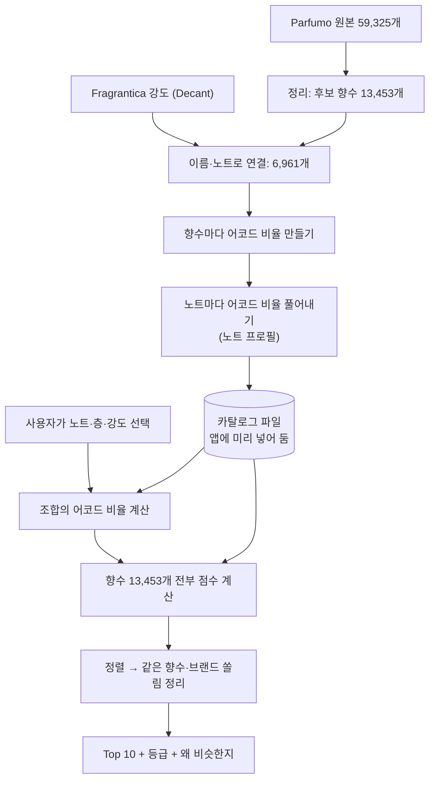

# 추천 엔진은 어떻게 계산하나

> **v8 안내(2026-11-05):** 계산식은 아래 v7과 같습니다. 달라진 것은 데이터입니다. 강도 자료가 없는 향수를 같은 몫·순위 비중 대신 **추정치**로 채우고 표시합니다(`pipeline/estimate.py`). 후보는 12,469개이고, 아래 숫자와 예시는 v7 기준입니다.
>
> 기준: 엔진 v7 · 후보 향수 13,453개. 코드(`pipeline/engine_ref.py`, `pipeline/build_catalog.py`, `pipeline/decant_join.py`)를 읽고 썼습니다.
> 예시 숫자는 실제 엔진으로 계산했고, 엔진 점수와 이 문서의 식으로 다시 계산한 값이 일치하는 것까지 확인했습니다. 다시 뽑는 방법: `py pipeline/experiments/explain_example.py`
> 블라인드 비교를 아직 답하지 않았다면 **12절(버전별 변화)은 답한 뒤에 읽어 주세요.** 예시 조합과 예시 향수는 블라인드 문서에 없는 것만 썼습니다.

## 1. 먼저 알아 둘 것

**이 엔진은 향을 맡거나 실제로 섞어 보지 않습니다.** 향 분자나 화학 반응도 계산하지 않습니다.

- 사람들이 향수 사이트(Parfumo, Fragrantica)에 남긴 정보를 숫자로 바꿉니다. 어떤 향수에 어떤 노트가 들었고, 어떤 느낌(어코드)이 얼마나 강하다고 느꼈는지입니다.
- 사용자가 고른 노트를 같은 방식의 숫자로 바꿉니다.
- 두 숫자가 얼마나 닮았는지 재서, 가장 닮은 실제 향수를 보여 줍니다.

그래서 "조합한다"는 말은 **노트마다 가진 느낌 비율을 더한다**는 뜻입니다. 실제로 그렇게 섞었을 때 나는 향을 예측하는 것은 아닙니다. 노트 강도도 **실제 함량이 아니라 사람들이 느낀 체감 강도**입니다.

## 2. 전체 흐름



위쪽 절반은 데이터를 만들 때 한 번만 계산하고, 아래쪽 절반은 사용자가 조합할 때마다 계산합니다.

## 3. 후보 향수 고르기

| 단계 | 남은 수 |
|---|---:|
| 원본 전체 | 59,325 |
| 탑·미들·베이스가 모두 있고, 노트 3개 이상, 어코드 1개 이상, 평가 10건 이상 | 14,089 |
| 같은 향수의 농도 중복 합치기 (303개 줄어듦) | 13,786 |
| 원본 데이터의 복사 오류 빼기 (333개 줄어듦) | **13,453** |

복사 오류는 브랜드가 다른데 노트·평가 수·어코드·조향사가 모두 같은 경우입니다. 뺀 목록은 `pipeline/copy_suspects.csv`에 남겨 두었습니다.

## 4. Fragrantica 강도 연결

Parfumo에는 어코드 이름만 있고 비율이 없습니다. 그래서 Fragrantica 사용자 투표를 정리한 Decant 데이터에서 **어코드 강도**와 **노트 강도**를 가져옵니다.

1. 브랜드와 이름이 같은 향수를 찾습니다. 연도가 맞는 쪽을 먼저 고릅니다.
2. 노트가 30% 미만으로 겹치면 이름만 같은 다른 향수로 보고 연결하지 않습니다.
3. 연결된 향수만 강도를 씁니다. **후보의 51.7%(6,961개)가 연결되고, 나머지는 강도 없이 계산합니다.**

Fragrantica의 어코드 92개는 앱의 21개로 묶습니다(`pipeline/manual/fragrantica_accords.csv`, 2026-11-02 사장 OK). 희귀 어코드 31개(비중 0.3%)는 버립니다.

## 5. 향수를 숫자로 바꾸기

어코드는 **시트러스, 플로럴, 우디 같은 느낌 21가지**입니다. 향수마다 합이 100이 되는 비율로 나타냅니다.

- **연결된 향수:** Fragrantica 강도를 합 100으로 맞춥니다.
- **연결 안 된 향수:** 목록 순서대로 5·4·3·2·1을 주고 합 100으로 맞춥니다(33.3 / 26.7 / 20.0 / 13.3 / 6.7).

예: Renato Balestra Argento

| 어코드 | 플로럴 | 시트러스 | 우디 | 프레시 | 시프레 | 어시 | 나머지 15개 |
|---|---:|---:|---:|---:|---:|---:|---:|
| 비율 | 38.3 | 17.8 | 14.4 | 10.7 | 9.8 | 9.1 | 0 |

## 6. 노트를 숫자로 바꾸기 (노트 프로필)

노트에는 원래 어코드 정보가 없습니다. 그래서 그 노트가 든 향수들에서 거꾸로 풀어냅니다.

**단순 평균을 쓰지 않는 이유:** 어떤 노트가 든 향수들의 어코드를 그냥 평균 내면 함께 든 다른 노트의 느낌까지 섞입니다.

**그래서 함께 든 노트의 몫을 나눕니다:** "향수의 어코드 비율은 그 향수에 든 노트 프로필의, 노트 강도 몫으로 가중한 평균과 비슷하다"고 놓고, 전체 향수에서 오차가 가장 작아지는 노트 프로필을 계산합니다(음수 없는 최소제곱, 400번 반복).

| 노트 | 단순 평균 상위 | 최종 프로필 상위 |
|---|---|---|
| 라임 | 시트러스 16.1 · 스파이시 12.5 · 우디 10.9 | **시트러스 63.0** · 그린 13.5 · 프레시 7.6 |
| 은방울꽃 | 플로럴 23.5 · 스위트 9.2 · 프레시 8.7 | **플로럴 53.9 · 프레시 27.3** · 그린 12.0 |
| 시더우드 | 우디 14.4 · 스파이시 13.9 · 플로럴 11.6 | **우디 72.6** · 프레시 17.0 · 스파이시 7.4 |

데이터가 적은 노트는 따로 보정합니다.

- 향수 20개 미만에 나오는 노트: 같은 계열의 평균 프로필을 그대로 씁니다.
- 향수 20개 이상에 나오는 노트: 계열 평균과 섞습니다. `(나오는 향수 수 × 자기 값 + 20 × 계열 평균) ÷ (나오는 향수 수 + 20)`
- 향수 4개 이하에 나오는 노트는 고를 수 없습니다. 5~29개는 검색으로만, 30개 이상은 목록에서 고릅니다.

## 7. 조합을 숫자로 바꾸기

고른 노트의 프로필에 **사용자가 고른 강도**를 곱해서 모두 더합니다. 약 0.5, 중 1.0, 강 3.0입니다.

예: 라임(탑) · 은방울꽃(미들) · 시더우드(베이스)

| 어코드 | 모두 중 | 시더우드만 강 |
|---|---:|---:|
| 우디 | 25.5% | **44.4%** |
| 시트러스 | 21.0% | 12.6% |
| 플로럴 | 18.0% | 10.8% |
| 프레시 | 17.3% | 17.2% |
| 그린 | 8.5% | 5.1% |
| 스파이시 | 3.3% | 5.0% |

화면에는 합이 100이 되도록 반올림하고 남는 차이를 1위 항목에 몰아주기 때문에, 표시값이 실제와 조금 다를 수 있습니다. 점수 계산에는 영향이 없습니다.

## 8. 향수마다 점수 매기기

불호 노트가 든 향수를 빼고, 남은 향수 전부에 두 가지 점수를 매겨 합칩니다.

### ① 어코드 유사도 (0~1)
조합과 향수의 어코드 비율이 **얼마나 같은 모양인지** 봅니다(코사인 유사도).

### ② 노트 일치도 (0~1)
**기본 일치도**에 **강도 몫**을 곱합니다.

```
노트 일치도 = 기본 일치도 × (0.3 + 0.7 × √강도 몫 합)
```

**기본 일치도:** 고른 노트마다 아래 점수를 주고, 드문 노트일수록 큰 비중으로 평균합니다. 비중은 `ln(1 + 후보 수 ÷ 그 노트가 든 향수 수)`입니다.

| 그 향수에서 | 점수 |
|---|---:|
| 같은 층에 있음 | 1.0 |
| 다른 층에 있음 | 0.5 |
| 그 노트는 없지만 같은 계열 노트가 있음 | 0.3 |
| 없음 | 0 |

**강도 몫 합:** 고른 노트가 그 향수 안에서 차지하는 몫을 더합니다. 향수의 모든 노트 몫을 더하면 1입니다.

- 연결된 향수의 몫은 Fragrantica 노트 강도에서 나옵니다. 투표가 적을수록 강도 차이를 줄입니다(α = 표 ÷ (표 + 70)).
- 강도가 없는 향수는 모든 노트를 같은 몫으로 봅니다. 노트가 12개면 노트 하나의 몫은 1/12입니다.

그래서 고른 노트가 **있기만 한 향수**보다 **그 노트가 두드러지는 향수**가 높은 점수를 받고, 노트가 많다는 이유만으로 유리해지지 않습니다.

### ③ 합치기

```
유사도 = (0.35 × 어코드 유사도 + 0.55 × 노트 일치도) ÷ 0.9      ← 화면 점수와 등급에 씀
순위 점수 = 유사도                                               (선호 계열 없음)
순위 점수 = 0.35 × 어코드 유사도 + 0.55 × 노트 일치도 + 0.1 × 선호 계열 비중  (선호 계열 있음)
```

**선호 계열은 순위에만 영향을 주고, 등급과 화면 점수는 바꾸지 않습니다.**

### 손으로 계산해 보기
조합: 라임(탑) · 은방울꽃(미들) · 시더우드(베이스), 모두 중. 향수: Renato Balestra Argento

1. 어코드 유사도 = **0.7990** (21개 어코드 전체로 계산)
2. 세 노트가 모두 같은 층에 있으므로 기본 일치도 = **1.0000**
3. 강도 몫 합 = 라임 0.0998 + 은방울꽃 0.1166 + 시더우드 0.0926 = **0.309**
4. 노트 일치도 = 1.0000 × (0.3 + 0.7 × √0.309) = **0.6891**
5. 유사도 = (0.35 × 0.7990 + 0.55 × 0.6891) ÷ 0.9 = **0.7319**

## 9. 순위에서 Top 10까지

1. 순위 점수가 높은 순서로 정렬합니다. 같으면 평가 수가 많은 쪽, 그래도 같으면 향수 key 순서입니다.
2. 위에서부터 담되, **농도만 다른 같은 향수는 하나만**, **한 브랜드는 최대 2개까지** 담습니다.
3. 10개가 차면 멈춥니다.
4. 유사도로 등급을 붙입니다.

| 유사도 | 등급 |
|---|---|
| 0.763 이상 | 매우 비슷 |
| 0.647 이상 | 비슷 |
| 그 아래 | 참고 |

**2026-11-05 v8 확정값입니다.** 무작위 조합 500개의 Top 10 유사도 중 상위 10%·40%이고, 사장님 눈 평가 점수로 검증했습니다(매우 비슷 4.68 > 비슷 3.93 > 참고 3.38). 자세한 표: `docs/engine_grade_v8.md`.

### 예시 결과: 라임 · 은방울꽃 · 시더우드 (모두 중)

| 순위 | 향수 | 유사도 | 어코드 유사도 | 노트 일치도 | 강도 몫 합 |
|---:|---|---:|---:|---:|---:|
| 1 | Renato Balestra — Argento | 0.7319 | 0.7990 | 0.6891 | 0.309 |
| 2 | L'Erbolario — Verde | 0.6789 | 0.7810 | 0.6140 | 0.201 |
| 3 | Versace — V/S for Men | 0.6702 | 0.8029 | 0.5858 | 0.167 |
| 4 | Superdry — Steel | 0.6669 | 0.6333 | 0.6883 | 0.308 |
| 5 | Rochas — Eau de Rochas Homme | 0.6589 | 0.6971 | 0.6346 | 0.229 |

## 10. 입력을 바꾸면 숫자가 어떻게 움직이나

같은 조합을 조금씩 바꿔 실제로 돌린 결과입니다.

| 바꾼 것 | 결과 |
|---|---|
| **시더우드만 강** | 우디 25.5% → 44.4%. 시더우드 몫이 큰 Nobile 1942 Estroverso가 3위로 들어옴. 1위 Argento는 0.7319 → 0.6553 |
| **모두 강** | 모두 중일 때와 **Top 10이 완전히 같음.** 비율 모양이 그대로이기 때문 |
| **라임과 시더우드의 층을 맞바꿈** | 어코드 비율은 그대로. Argento는 기본 일치도 1.0000 → 0.6622로 1위에서 2위로, 유사도 0.7319 → 0.5896 |
| **선호 계열을 우디로 설정** | 순위 점수만 0.7319 → 0.6919. 유사도와 등급은 그대로 |

- **사용자가 고른 강도는 노트끼리의 상대적인 비율만 바꿉니다.** 모두 올리면 아무 변화가 없습니다.
- **층은 어코드 계산에 영향이 없고**, 기본 일치도에서만 쓰입니다.

## 11. 어떻게 검증하고 있나, 그리고 한계

### 시험 현황

| 시험 | 하는 일 | 기준 | v7 | v6 |
|---|---|---:|---:|---:|
| 재현 | 평가 많은 향수의 노트를 그대로 넣으면 그 향수가 Top 3에 나오나 | 15/20 | 20/20 | 20/20 |
| 재현 100개 | 같은 시험을 100개로 | (참고) | 100/100 | 99/100 |
| 층마다 2개 / 노트 하나 뺌 (100개) | 어렵게 재현 | (참고) | 97 / 99 | 98 / 97 |
| 맹점 | 시트러스·플로럴 조합의 Top 5 중 둘 다 가진 향수 수 | 4/5 | 4/5 | 4/5 |
| 다양성 | 12개 조합의 Top 10에 나온 서로 다른 브랜드 수 | 40개 | 92 | 97 |
| 사람 유사 (남겨 둔 절반, Top 50) | "비슷하다"고 투표된 향수가 Top 50에 오나 | v6보다 높음 | **44.3%** | 38.4% |
| 사람 유사 (층마다 1개, Top 50) | 실제 사용에 가까운 입력으로 | (참고) | 32.8% | 29.7% |
| 블라인드 (v8 vs v7, 채팅 AI 판정) | 두 엔진의 추천 목록을 비교해 고르기 | 양측 부호 검정 p<0.05 | **13:13, 유의차 없음** | — |
| 눈으로 평가 (v8, 사장 점수) | 사람이 추천 결과에 1~5점 매기기 | 평균 3.5 | **4.38 합격** | — |
| 엔진 일치 | Python과 앱(TypeScript) 엔진 결과가 같은가 | 전부 일치 | 통과 | — |

자세한 표: `docs/engine_report.md`, `docs/engine_similar_votes.md`, `docs/engine_v2_trial.md`

### 지금 엔진의 한계

**이번에 새로 생긴 것**
1. **강도 데이터가 있는 향수로 쏠립니다.** 전체의 52%인데 비교 조합 Top 10에서는 81%입니다(v6은 58%). 연결 안 된 향수는 노트 몫을 같게 나누어서 고른 노트의 몫이 작게 나오기 쉽습니다.
2. **등급이 대부분 "참고"입니다.** 9절 참고. 기준값을 사장님이 정해야 합니다.
3. **어코드 값의 출처가 섞입니다.** 연결된 향수는 실제 강도, 나머지는 5·4·3·2·1 추정치입니다.

**계속 남아 있는 것**
4. **평가 수는 동점일 때만 씁니다.** 위 예의 1위 Argento는 평가가 15건입니다.
5. **층의 차이는 어코드에 반영되지 않습니다.** 층별 지속 시간이나 휘발을 계산하지 않습니다.
6. **노트끼리의 상호작용은 없습니다.** 더하기만 합니다.
7. **데이터의 표기 습관이 결과에 남습니다.**
8. **숫자 시험은 실제 향이 비슷한지 증명하지 않습니다.** 사람 유사 시험의 정답도 사람들의 인식이고, 블라인드도 시향이 아니라 이름과 어코드를 보고 판단합니다.

**v7에서 나아진 것**
- 노트가 많은 향수가 유리하던 문제가 줄었습니다. 비교 조합 Top 10의 노트 수 중앙값이 11개 → 9개입니다(전체 향수 중앙값 9개).
- 선호 계열을 켜도 등급이 내려가지 않습니다.
- 5·4·3·2·1 추정치를 연결된 향수에서는 실제 강도로 바꿨습니다.

### 데이터 이용 조건
Decant는 Kaggle 표기가 **CC BY-NC-SA 4.0**입니다. 비상업 용도만 가능하고, 출처를 밝히며, 이 데이터로 만든 카탈로그를 나눌 때는 같은 조건으로 공유해야 합니다. Fragrantica 자체 약관은 사이트가 자동 접근을 막아 읽지 못했으니 정식 공개 전에 확인해야 합니다. 받은 데이터와 카탈로그는 저장소에 커밋하지 않습니다.

## 12. 버전별 변화와 숫자 모음

> 블라인드 비교를 답하기 전이라면 이 절은 나중에 읽어 주세요.

| 버전 | 바뀐 것 | 이유 |
|---|---|---|
| v2 | 어코드:노트 60:30 → 45:45 | 재현 9/20 → 15/20 |
| v3 | 프로필을 특징 강조 방식으로, 강 1.5 → 2.0 | 레몬 '강'이 '중'과 거의 같던 문제 |
| v4 | 어코드:노트 45:45 → 35:55 | 노트가 다 맞아도 어코드 차이로 밀림 |
| v5 | 프로필을 '함께 든 노트의 몫 빼기'로, 복사 오류 제외 | 머스크 '강'이 플로럴을 키우던 문제 |
| v6 | 강 2.0 → 3.0 (어코드 쪽에만) | 레몬 '강'이 시트러스를 충분히 못 키움 |
| v7 | 어코드·노트 강도, 일치도 × 강도 몫, 선호를 뺀 등급 | 사람 유사 시험 Top 50 38.4% → 44.3% |
| v8 | 강도 없는 향수에 추정치(P1), 합치기 노트 겹침 검사, 데이터 정리 | 사람 유사 -2.5%p, 가림 +9.3%p, W +2.4 (`docs/engine_v8_check.md`) |

| 숫자 | 값 | 어디에 쓰나 |
|---|---:|---|
| 어코드 / 노트 / 선호 가중치 | 0.35 / 0.55 / 0.1 | 점수 |
| 같은 층 / 다른 층 / 같은 계열 | 1.0 / 0.5 / 0.3 | 기본 일치도 |
| 강도 몫 기본값 | 0.3 | 노트 일치도 |
| 표 수 기준 | 70표 | 노트 강도 몫 |
| 강도 하한 | 0.05 | 노트 강도 몫 |
| 노트 겹침 최소 | 30% | Fragrantica 연결 |
| 약 / 중 / 강 | 0.5 / 1.0 / 3.0 | 조합 어코드 비율 |
| 탑 / 미들 / 베이스 가중치 | 1.0 / 1.0 / 1.0 | 조합 어코드 비율 |
| 어코드 순위 비중 | 5 / 4 / 3 / 2 / 1 | 연결 안 된 향수의 어코드 비율 |
| 계열 평균과 섞는 값 K | 20 | 노트 프로필 |
| 계열 평균을 그대로 쓰는 기준 | 향수 20개 미만 | 노트 프로필 |
| 층마다 고를 수 있는 노트 | 최대 3개 | 입력 제한 |
| 한 브랜드 최대 | 2개 | Top 10 |
| 등급 기준 | 0.763 / 0.647 | 등급 |

**코드 위치**
- 후보 고르기·노트 프로필: `pipeline/build_catalog.py`, `pipeline/catalog_rules.py`
- Fragrantica 연결: `pipeline/decant_join.py`, `pipeline/fetch_decant.py`, `pipeline/manual/fragrantica_*.csv`
- 점수 계산: `pipeline/engine_ref.py` (기준), `app/src/engine/RecommendationEngine.ts` (앱, 골든 테스트로 일치 확인)
- 숫자 설정: `pipeline/engine_ref.py` 맨 위, `app/src/engine/params.ts`
- 시험: `pipeline/evaluate.py`, `pipeline/experiments/similar_votes.py`
- 설계 명세: `docs/design.md` 8절
