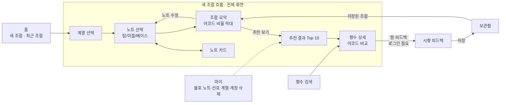

# scent-studio 기획서 (1차)

> 작성: 기획팀 · 2026-10-30
> 이 문서는 /build-app 1단계 결과물이다. 사장과 Claude 앱 대화에서 정리한 기획 전달 자료와,
> 다른 AI 기획안 2건(구글 문서 "나만의 향 조합 앱 기획 요약", Word "향수 노트 조합 및 유사 향수 추천 앱 기획서") 검토 결과를 합쳤다.
> **저장소 밖 문서와 내용이 다르면 이 문서가 기준이다.**

## 목표
사용자가 탑·미들·베이스 노트를 직접 골라 "나만의 향"을 조합하면, 실제 판매 향수 중
**전체 분위기(어코드 비중)가 가장 비슷한** 제품을 유사도 순으로 추천한다.
추천은 점수만 보여 주지 않고 "왜 비슷한지"(어코드 비율 비교, 일치한 노트)를 함께 보여 준다.

## 사용자
- 향수를 좋아하지만 노트·향 계열을 잘 모르는 입문자 (20~30대)
- 쓰는 곳: **안드로이드 폰 전용** (2026-10-30 사장 결정으로 변경. 웹·PC 브라우저는 지원하지 않음)
- 플랫폼: 안드로이드 앱(Kotlin)으로 만들어 Play 스토어로 배포한다

## 핵심 개념 (모든 팀 공통 용어)
| 용어 | 뜻 |
|---|---|
| 노트 | 향을 이루는 개별 재료 이름 (레몬, 장미, 샌달우드 …) |
| 층 | 탑(처음) · 미들(중심) · 베이스(잔향). 노트마다 사용자가 층을 정해 고른다 |
| 계열 | 노트를 묶는 큰 분류 (시트러스, 플로럴, 우디 …) |
| 어코드 | 향수 전체의 분위기 테마와 그 비율 (예: 시트러스 60 · 플로럴 30 · 우디 10) |
| 강도 | 사용자가 노트마다 고르는 세기: 약 0.5 / 중 1.0 / 강 1.5 |
| 불호 노트 | 사용자가 싫다고 표시한 노트. 이 노트가 든 향수는 추천에서 아예 뺀다 |

## 추천 규칙 (가장 중요한 결정)
**어코드 비중을 메인으로, 노트 일치는 보조로 쓴다.**
- 이유: 노트 포함 여부만 보면 "레몬 + 오스만투스 + 샌달우드"를 고른 사람에게, 세 노트가 다 들었지만
  샌달우드가 지배하는 묵직한 우디 향수가 1순위로 나온다. 어코드 비중으로 비교하면 가벼운 조합에는
  가벼운 향수가 나온다.
- 점수 = 어코드 비중 유사도 60% + 단계별 노트 일치도 30% + 개인 취향 10%
  (취향 정보가 없는 사용자는 60:30을 2:1로 나눠 100%를 만든다)
- 불호 노트는 점수가 아니라 **후보 제외 필터**다.
- 정확한 계산식과 순서는 `design.md` "추천 엔진 명세"를 따른다. 가중치는 시작값이며 시향 피드백으로 조정한다.

## 기능 우선순위
### 1차 (MVP, 이번에 만든다)
| 순위 | 기능 | 설명 |
|---|---|---|
| 1 | 노트 선택 | 계열 선택(복수) → 탑·미들·베이스 층별로 노트 1~3개, 노트 검색(한글·영문), 노트별 강도. 목록에는 자주 쓰이는 노트(약 540종)만, 나머지는 검색으로 |
| 2 | 노트 카드 | 한 줄 설명, 계열, 자주 함께 쓰이는 노트 3개(궁합 힌트) |
| 3 | 조합 요약 | 층별 노트 정리, 조합의 어코드 비율 막대, 균형 안내(빈 층, 한 계열만, 한 어코드가 너무 강함, 대비가 큼) |
| 4 | 유사 향수 추천 | Top 10: 유사도 점수와 등급(매우 비슷 / 비슷 / 참고), 공통 어코드, 일치한 노트. 한 브랜드는 최대 2개. **앱 안에서 계산해 인터넷 없이도 된다** |
| 5 | 향수 상세 | 노트 피라미드, 내 조합 vs 향수 어코드 비율 비교 막대, 일치·차이 노트 |
| 6 | 불호 노트 필터 | 마이에서 설정, 추천에 자동 적용. 로그인 없이도 폰에 저장해 바로 적용하고, 로그인하면 서버 값과 합친다 |
| 7 | 저장 | 조합 저장, 향수 찜 (로그인 필요) |
| 8 | 시향 피드백 | 만족도 1~5, "조합과 비슷했나" 1~5, 메모 (로그인 필요) |
| 9 | 로그인 | 구글 로그인 1종. 비로그인도 조합·추천까지는 사용 가능 |
| 10 | 계정 삭제 | 마이에서 계정과 내 데이터를 모두 삭제 (Play 정책 필수). 웹에서 삭제를 요청하는 방법도 안내 페이지로 제공 |
| 11 | 사용 기록 | 화면 없음. 성공 기준을 재기 위한 최소한의 기록(조합 시작·완료, 추천 보기, 저장 등). 광고 ID는 쓰지 않음 |

### 다음 차수 후보 (이번에는 만들지 않는다, 순서대로)
- 2차: 기존 향수 변형(좋아하는 향수를 불러와 노트 더하고 빼기), 대체 향수 찾기, 계절·TPO 태그와 필터, 향 전개 미리보기(탑→미들→베이스 키워드)
- 3차: 향수 2~3개 비교, 지속력·발향력·가격대 필터(데이터가 있을 때만), LLM이 쓰는 추천 이유 문장
- 4차: 마이 향기 리포트(선호 어코드 방사형 그래프), 피드백으로 개인별 가중치 조정
- 5차: 레시피 공유 커뮤니티, SNS 공유 카드, 레이어링 추천(실험)

## 하지 않을 것 (1차)
- 가격·구매 링크·재고 표시 (공개 데이터에 가격이 거의 없음)
- 지속력·발향력 필터, 향수 비교, 커뮤니티, 레이어링
- 브랜드 공식 향수 이미지 사용 (저작권). 향수 카드는 계열 색과 이름으로 표시
- "실제 향이 같다"는 식의 표현. 화면에는 "데이터상 유사도"라고 쓴다
- 사용자가 데이터를 직접 입력·수정하는 기능 (카탈로그는 읽기 전용)
- 웹사이트·PC 화면, 아이폰 앱 (안드로이드 앱 전용)
- Play 스토어 정식 공개. 1차는 **Play 내부 테스트(초대한 사람만)**까지. 정식 공개는 데이터 라이선스를 확인한 뒤 정한다

## 화면 흐름도

하단 탭 4개: 홈 · 향수 찾기 · 보관함 · 마이 (2026-10-30 변경: "향 만들기" 탭 대신, 홈에서 시작하는 전체 화면 흐름. 만들던 조합은 자동 임시 저장되어 홈에서 이어 할 수 있다)

| ID | 화면 | 위치 |
|---|---|---|
| S01 | 홈 (새 조합 시작, 만들던 조합 이어 하기, 최근 조합) | 홈 탭 |
| S02 | 계열 선택 | 새 조합 흐름 |
| S03 | 노트 선택 (층 탭, 검색, 강도) | 새 조합 흐름 |
| S04 | 노트 카드 (아래에서 올라오는 시트) | 새 조합 흐름 |
| S05 | 조합 요약 | 새 조합 흐름 (보관함에서 저장된 조합을 열 때도) |
| S06 | 추천 결과 | 새 조합 흐름 |
| S07 | 향수 상세 | 새 조합 흐름 · 향수 찾기 탭 |
| S08 | 향수 검색 | 향수 찾기 탭 |
| S09 | 보관함 (조합 · 찜 · 시향 기록) | 보관함 탭 |
| S10 | 시향 피드백 작성 | 보관함 탭 |
| S11 | 마이 (불호 노트, 선호 계열, 계정, 계정 삭제) | 마이 탭 |
| S12 | 로그인 | 필요할 때 |

## 데이터 출처
- 향수 카탈로그: Parfumo 데이터셋 CSV (TidyTuesday 2024-12-10, Kaggle 원본). 실사 결과는 `design.md` 5절
- 노트 계열은 데이터에서 계산하고, 한글명·설명은 직접 만든다. FragDB는 필수가 아니며 무료 샘플만 참고로 쓴다
- 이 데이터는 라이선스 표시가 없는 수집 데이터다. 정식 공개 전에 상업 이용 가능 여부를 확인한다. 화면에 출처를 표시한다
- 개인정보처리방침과 계정 삭제 요청 안내는 정적 웹페이지(GitHub Pages)로 만든다
- 소스 전체 목록·주의점과 조향 기초 자료는 `reference.md`

## 성공 기준 (베타 10명 기준으로 측정, 사용 기록으로 계산 — `design.md` 13절)
- 조합 완성률: 조합 시작 → 추천 결과 도달 비율
- 추천 저장률, 시향 피드백률
- "조합과 비슷했나" 평균 점수
- 재방문율

## 검증할 가설
1. 어코드 중심 추천이 노트 일치 중심 추천보다 "조합과 비슷했다" 점수가 높다
2. 어코드 비율 막대와 일치 노트를 함께 보여 주면 추천을 더 믿는다
3. 시향 피드백이 다음 추천 만족도를 높인다

## 다른 AI 기획안에서 고르고 뺀 것 (요약)
| 제안 | 판단 |
|---|---|
| 어코드 비중 메인 + 노트 일치 보조 | 채택 (핵심) |
| 가중치 노트 35 / 계열 20 / 단계 20 / 어코드 15 / 취향 10 | 수정: 어코드 60 / 노트 30 / 취향 10 (계열·단계는 노트 일치 안에 포함) |
| 불호 노트 필터, 궁합 힌트, 조합 요약·균형 경고 | 1차 채택 |
| 노트별 강도 | 1차 채택 (추가 제안) |
| 기존 향수 변형, 대체 향수, 향 전개 미리보기, 계절·TPO | 2차 |
| 향수 비교, 지속력·발향력·가격 필터 | 3차 (데이터 있을 때만) |
| 마이 향기 리포트 | 4차 |
| 커뮤니티, 레이어링 | 5차 / 보류 |
